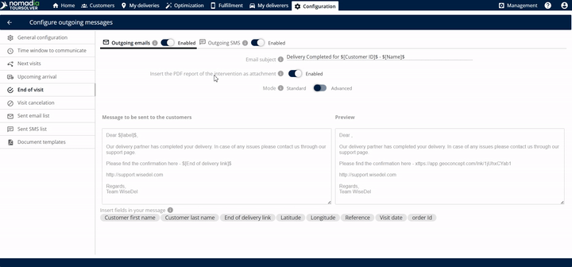
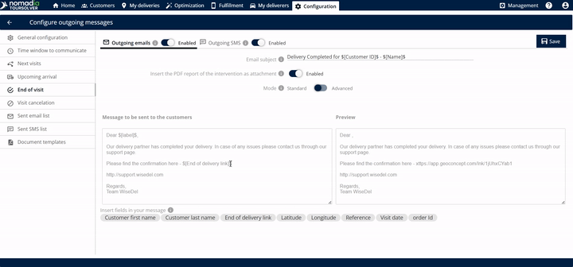
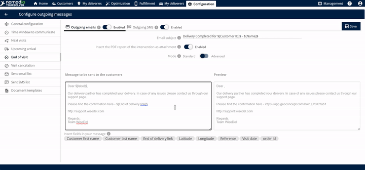
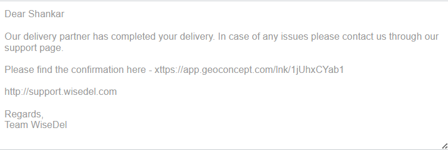

# Fim da Visita

## 1. Introdução

O **Fim da Visita** a configuração de comunicação permite automatizar mensagens de acompanhamento enviadas ao seu cliente.

**O que é o Fim da Visita?** É o processo que ocorre **uma vez que a entrega tenha sido concluída**. Após a conclusão, o cliente recebe automaticamente um e-mail com um arquivo PDF anexado.

**O PDF Prova de Entrega (PoD)** Este PDF anexado serve como prova oficial de entrega. Ele confirma detalhes essenciais para o cliente, incluindo:

* O nome do cliente
* O endereço do cliente
* Assinaturas coletadas durante a visita

## 2. Configuração Inicial

Antes de enviar sua primeira mensagem, você deve ativar os canais básicos de comunicação.

1. **Acesse as Configurações de Fim da Visita:**
   * Clique na **Fim da Visita** opção para acessar a tela de configuração.

2. **Ative os Canais de Saída:**
   * Ative o **e-mails de saída** opção

3. **Defina o Assunto do E-mail**

4. Ative o interruptor para enviar o PoD como um arquivo PDF

5. Clique na **Salvar** botão para aplicar as alterações ao modelo modificado.

## 3. Explicações de Recursos com Benefícios

Este recurso oferece flexibilidade e entrega clara de documentação.

| Recurso                                 | Descrição                                                                                                                                         |
| --------------------------------------- | ------------------------------------------------------------------------------------------------------------------------------------------------- |
| **Link de ETA**                         | Um link contendo o tempo estimado de chegada (ETA) é criado automaticamente e enviado assim que a entrega for concluída.                          |
| **Edição do Assunto do E-mail**         | Você pode inserir e personalizar o **assunto do e-mail** para que os clientes saibam imediatamente o propósito da mensagem.                       |
| **Edição do Corpo da Mensagem**         | Você pode livremente **editar a mensagem** que será enviada aos seus clientes, permitindo linguagem personalizada e detalhes importantes          |
| **Tags de Personalização ($)**          | Ao inserir o **símbolo do dólar** ($) são mostradas opções que você pode inserir e editar diretamente no corpo do e-mail, economizando seu tempo. |
| **Janela de Visualização**              | Antes de salvar, você pode ver a **visualização** da mensagem exata que será enviada, garantindo que ela pareça profissional e precisa.           |
| **Rastreamento de Localização ao Vivo** | O link permite que o cliente acompanhe a localização ao vivo da entrega (ou do entregador).                                                       |
| **E-mail de Saída**                     | Opção para permitir o envio do link de ETA por e-mail.                                                                                            |
| **SMS de Saída**                        | Opção para permitir o envio do link de ETA por mensagem de texto.                                                                                 |

## 4. Personalizando e Revisando o Assunto

Siga estes passos para personalizar o corpo da mensagem e confirmar a aparência final do e-mail.

1. **Selecione o Modo de Comunicação:**
   * Altere a **forma de comunicação** para **padrão** ou **avançado** com base no nível de detalhe necessário.

2. **Visualize a Mensagem Atual:**
   * Observe a seção que mostra a **mensagem a ser enviada ao cliente**.
3. **Edite o Corpo da Mensagem (Opcional):**
   * Se precisar ajustar o conteúdo, você pode **editar este corpo do e-mail**.

4.  **Visualize o E-mail Final:**

    * Revise o **Assunto:** Verifique a **visualização** área para ver exatamente como o e-mail final ficará para o cliente. Esta é sua chance de revisar a mensagem antes de salvar
    * **Insira Informações Personalizadas (Opcional)** Para incluir informações dinâmicas (como o nome do cliente ou detalhes específicos do agendamento), insira o **símbolo do dólar** ($). Isso mostrará opções que você pode usar para editar o corpo do e-mail.

    > 💡 **Dica:** Usar tags de personalização faz a mensagem soar mais direta e profissional.

5. **Salve a Configuração:**
   * Uma vez satisfeito com as configurações e a visualização, clique em **Salvar**.

6. O cliente receberá o seguinte e-mail

<figure><figcaption></figcaption></figure>

***

## 5. Dicas de Produtividade

Use estas dicas para maximizar a eficácia e a clareza de suas comunicações com os clientes.

* **💡 Verifique Antecipadamente o Conteúdo do PoD:** Lembre-se de que o anexo em PDF é crucial. Você pode se lembrar de que o cliente irá verificar seu nome, endereço e assinaturas dentro do anexo.
* **💡 Use a Visualização com Frequência:** Antes de salvar quaisquer alterações, use o recurso de visualização para verificar a formatação e garantir que o corpo da mensagem esteja legível. A visualização mostra exatamente o que o cliente verá.
* **💡 Verifique a Inclusão do Anexo:** Sempre certifique-se de ter ativado a opção para **Inserir o relatório em PDF da intervenção como anexo**. Isso garante que a prova necessária de entrega esteja incluída.
