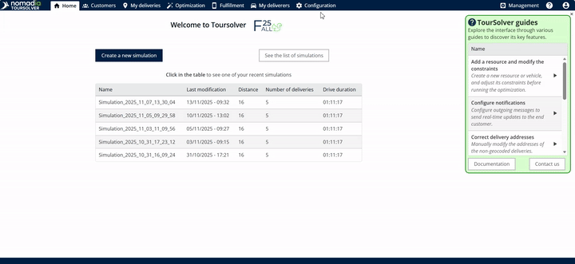
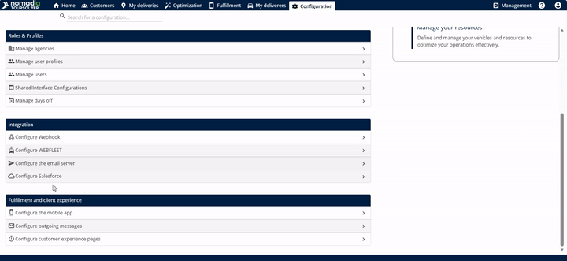
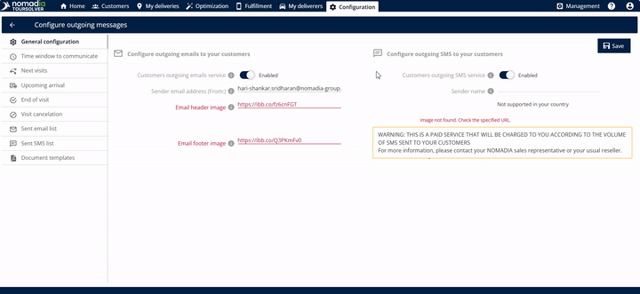
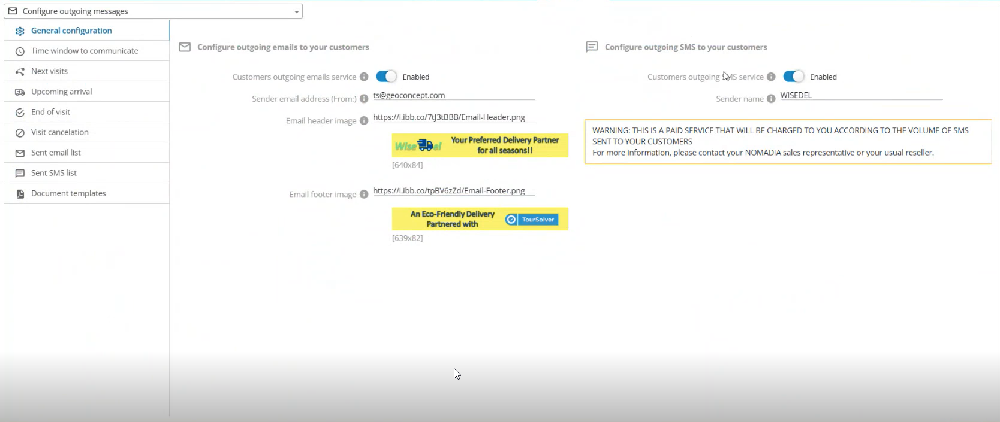
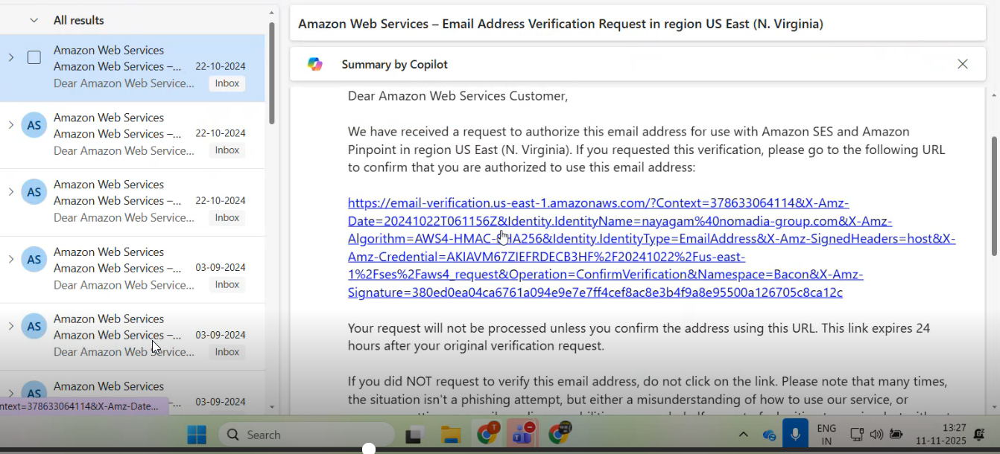
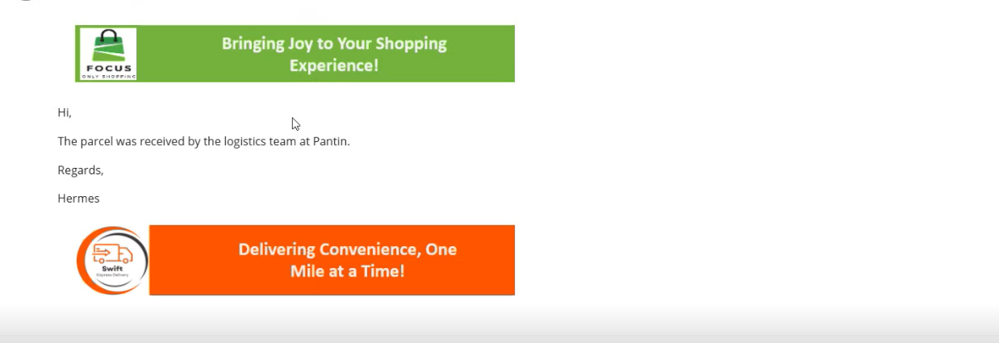

# Configuração Geral

## 1. Introdução

O **Configuração Geral de Comunicação com o Cliente** a tela permite que você ative, desative e personalize as configurações básicas para o envio de mensagens para seus clientes. Você tem o poder de controlar tanto o **serviço de email de saída para clientes** e o **serviço de SMS de saída para clientes**.

## 2. Configuração Inicial

Para começar a configurar suas preferências de comunicação com o cliente, você precisa navegar até a tela de Configuração Geral:

1. **Comece pela Página Inicial:** Vá a partir do **página inicial**.

2. Clique em **Configurar Mensagem de Saída**

3. **Abra Configuração Geral:** Você chegará à **Configuração geral** da tela.

***

## 3. Explicação de Funcionalidades e Benefícios

Esta área de configuração gerencia duas formas poderosas de alcançar seus clientes:

| Recurso                                     | Descrição e Utilidade                                                                                                                                                                                |
| ------------------------------------------- | ---------------------------------------------------------------------------------------------------------------------------------------------------------------------------------------------------- |
| **Serviço de Email de Saída para Clientes** | Permite que o sistema envie e-mails aos clientes em seu nome. **Benefício:** Você pode personalizar a aparência dos seus e-mails usando elementos de marca, como suas imagens de cabeçalho e rodapé. |
| **Serviço de SMS de Saída para Clientes**   | Permite que o sistema envie mensagens de texto (SMS) diretamente aos clientes. **Benefício:** Fornece comunicação rápida e direta para atualizações urgentes ou importantes.                         |

**Considerações Principais para SMS:**

* ⚠️ **Aviso: Serviço Pago** – Ativar o serviço de SMS de saída é um **serviço pago**. Você será cobrado com base no volume de mensagens SMS enviadas aos seus clientes.
* **Limite de Caracteres** – Cada mensagem SMS padrão deve ter **160 caracteres**. Se sua mensagem exceder 160 caracteres, o sistema automaticamente **dividirá o SMS em dois SMS**.

***

## 4. Configurando a Comunicação com o Cliente

Esta seção orienta você pelo processo de configuração e ativação tanto do seu canal de e-mail quanto do de SMS.

#### Ativando e Personalizando o Email de Saída

Use estas etapas para ativar a comunicação por e-mail e garantir que seus e-mails tenham aparência profissional com suas imagens de marca.

1. **Ativar Serviço de Email:** Uma vez na tela de Configuração Geral, ative o **serviço de email de saída para clientes**.
2. **Insira o Email do Remetente:** Insira o **endereço de e-mail do remetente**.

3. **Adicionar Link de Imagem de Cabeçalho/Rodapé (Opcional):** Digite o **link da imagem de cabeçalho/rodapé**. Isso frequentemente contém informações legais ou dados de contato. 💡 **Dica:** Se você não inserir um link de imagem de cabeçalho e um link de imagem de rodapé, o e-mail resultante será enviado sem esses elementos visuais.

#### Ativando o SMS de Saída

1. **Ativar Serviço de SMS:** Localize e ative o **serviço de SMS de saída para clientes**.
   * **Contexto:** Se você ativar este serviço, seus clientes começarão a receber mensagens SMS do sistema.

#### Salvando Alterações e Validando Seu Email

Para ativar sua configuração de comunicação, você deve salvar suas modificações e completar uma etapa importante de validação.

2. **Receber Email de Validação:** Após clicar **salvar**, o sistema enviará automaticamente um e-mail para o endereço do remetente que você forneceu. Este e-mail inclui um **link para validar o e-mail**.

<figure><figcaption></figcaption></figure>

3. **Clique no Link de Validação:** Vá para sua caixa de entrada, abra o e-mail de validação e clique no link fornecido.

<figure><figcaption></figcaption></figure>

4. **Ativação Confirmada:** Uma vez que você clique no link, o sistema estará autorizado a enviar e-mails aos clientes **em seu nome**.

<figure><figcaption></figcaption></figure>

***

## 5. Dicas de Produtividade

Aqui estão algumas dicas para maximizar sua eficácia ao usar as configurações da Configuração Geral:

* 💡 **Marca Consistente:** Tente sempre inserir tanto o **link da imagem de cabeçalho** e o **link da imagem de rodapé**. Usar esses links ajuda a manter uma marca profissional em todos os e-mails enviados aos seus clientes.
* ⚠️ **Fique de Olho na Contagem de Caracteres:** O envio de SMS é por assinatura paga e ao enviar mensagens SMS, lembre-se do **limite de 160 caracteres**. Mantenha suas mensagens concisas para evitar que sejam divididas em duas mensagens separadas e cobradas.
* 💡 **Validação Imediata:** Para garantir a entrega perfeita de e-mails, complete a etapa de validação imediatamente após clicar **salvar**. O link de validação confirma que o sistema (TourSolver) tem permissão para enviar mensagens usando o endereço de remetente escolhido.
