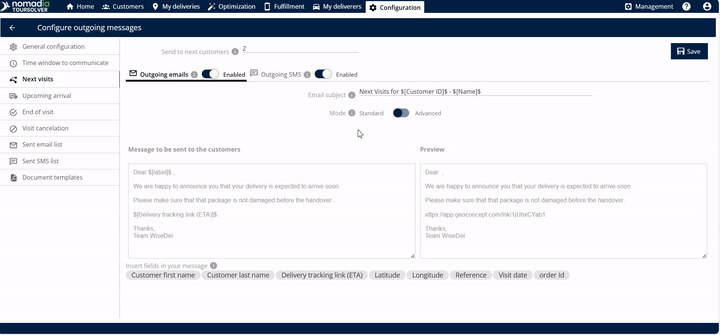
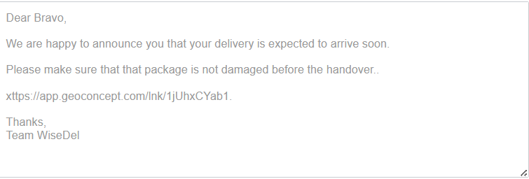

# Próximas visitas

## 1. Introdução

O **Próximas Visitas** recurso foi projetado para automatizar notificações, informando aos seus clientes futuros que você está a caminho. Isso garante uma comunicação tranquila e melhor preparação para sua chegada.

Você pode escolher exatamente quantos clientes futuros recebem esta mensagem, personalizar o conteúdo e decidir se envia por e-mail ou SMS.

## 2. Configuração Inicial

Seu primeiro passo é definir como você notificará seus clientes futuros.

**Acesse o Recurso Próximas Visitas:** Clique em **próximas visitas**.

**Defina a Quantidade de Clientes Alvo** Especifique o número de clientes futuros que você deseja notificar. Você pode escolher enviar uma notificação para o próximo, dois ou três clientes.

* Se você inserir **um**, o e-mail é enviado para o próximo cliente.
* Se você inserir **dois**, o e-mail é enviado para os próximos dois clientes.
* Se você inserir **três** (ou qualquer número que desejar), o e-mail é enviado para essa quantidade de clientes.

***

## 3. Explicações de Recursos com Benefícios

A força desta ferramenta está em sua personalização e no mecanismo de acionamento.

| Recurso                                 | Descrição                                                                                                                                         |
| --------------------------------------- | ------------------------------------------------------------------------------------------------------------------------------------------------- |
| **Link de ETA**                         | Um link contendo o tempo estimado de chegada (ETA) é criado automaticamente e enviado assim que a entrega for concluída.                          |
| **Edição do Assunto do E-mail**         | Você pode inserir e personalizar o **assunto do e-mail** para que os clientes saibam imediatamente o propósito da mensagem.                       |
| **Edição do Corpo da Mensagem**         | Você pode livremente **editar a mensagem** que será enviada aos seus clientes, permitindo linguagem personalizada e detalhes importantes          |
| **Tags de Personalização ($)**          | Ao inserir o **símbolo do dólar** ($) são mostradas opções que você pode inserir e editar diretamente no corpo do e-mail, economizando seu tempo. |
| **Janela de Visualização**              | Antes de salvar, você pode ver a **visualização** da mensagem exata que será enviada, garantindo que ela pareça profissional e precisa.           |
| **Rastreamento de Localização ao Vivo** | O link permite que o cliente acompanhe a localização ao vivo da entrega (ou do entregador).                                                       |
| **E-mail de Saída**                     | Opção para permitir o envio do link de ETA por e-mail.                                                                                            |
| **SMS de Saída**                        | Opção para permitir o envio do link de ETA por mensagem de texto.                                                                                 |

## 4. Personalize e Salve as Configurações de Comunicação com o Cliente

Esta tarefa garante que seus clientes futuros recebam uma mensagem personalizada notificando-os da sua chegada iminente.

1. **Digite o Assunto do E-mail:** Encontre o campo para o assunto do e-mail e digite um título claro e conciso.

2. **Edite o Conteúdo da Mensagem** Personalize o corpo da mensagem que será enviado aos seus clientes.
3.  **Insira Informações Personalizadas (Opcional)** Para incluir informações dinâmicas (como o nome do cliente ou detalhes específicos do agendamento), insira o **símbolo do dólar** ($). Isso mostrará opções que você pode usar para editar o corpo do e-mail.

    > 💡 **Dica:** Usar tags de personalização faz a mensagem soar mais direta e profissional.

4. **Revise o Assunto:** Verifique a **visualização** área para ver exatamente como o e-mail final ficará para o cliente. Esta é sua chance de revisar a mensagem antes de salvar.
5. **Salve Suas Configurações** Depois de inserir e modificar todas as informações necessárias, clique em **salvar**.

6. O cliente receberá o seguinte email.&#x20;

<figure><figcaption></figcaption></figure>

***

## 5. Dicas de Produtividade

Aqui estão algumas dicas para maximizar a eficiência do recurso de comunicação Próximas Visitas:

1. **Maximize a Personalização:** Sempre use o símbolo de dólar ($) ao editar o corpo da mensagem. Isso garante que você utilize os campos disponíveis para conteúdo dinâmico, criando uma comunicação profissional e detalhada sem entrada manual a cada vez.
