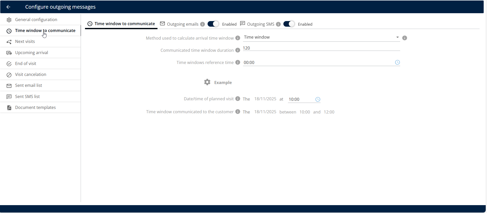
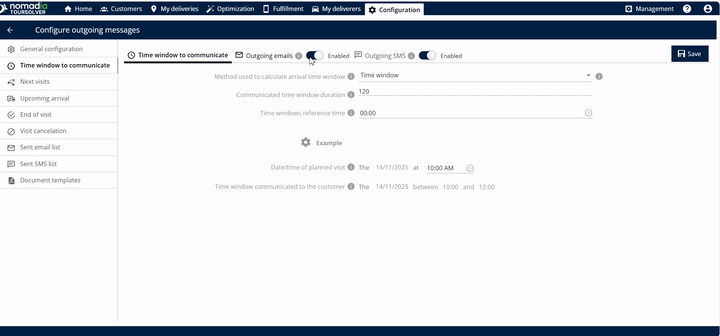
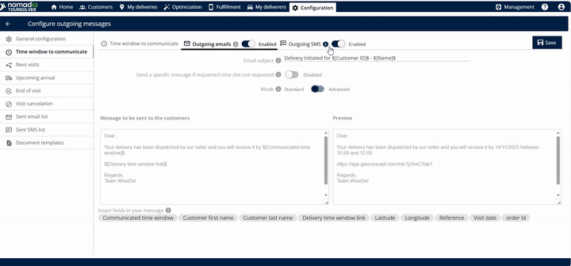
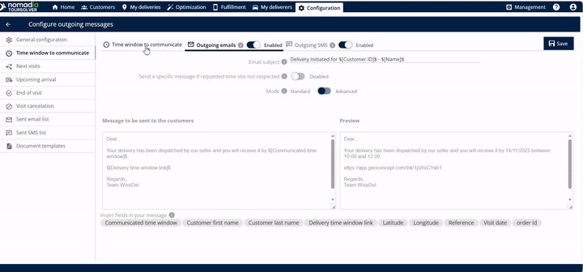
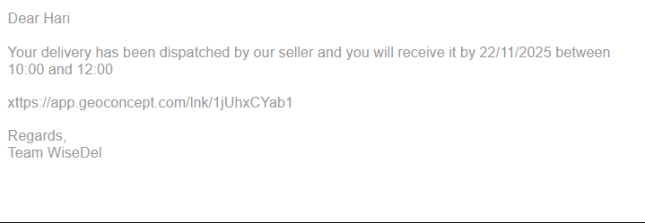

# Janela de Tempo para Comunicar

## 1. Introdução

O **Janela de Tempo para Comunicar** recurso permite que você defina o período exato comunicado ao seu cliente sobre uma visita futura. Isso calcula a janela de chegada e gerencia a comunicação de saída por e-mail e SMS.

## 2. Configuração Inicial

1. Clique em **Janela de tempo para comunicar**.

<figure><figcaption></figcaption></figure>

***

## 3. Explicação de Funcionalidades e Benefícios

Este recurso é poderoso porque permite que você controle exatamente como a informação de chegada é calculada e entregue.

| Recurso                                 | Descrição                                                                                                                                         |
| --------------------------------------- | ------------------------------------------------------------------------------------------------------------------------------------------------- |
| **Link de ETA**                         | Um link contendo o tempo estimado de chegada (ETA) é criado automaticamente e enviado assim que a entrega for concluída.                          |
| **Edição do Assunto do E-mail**         | Você pode inserir e personalizar o **assunto do e-mail** para que os clientes saibam imediatamente o propósito da mensagem.                       |
| **Edição do Corpo da Mensagem**         | Você pode livremente **editar a mensagem** que será enviada aos seus clientes, permitindo linguagem personalizada e detalhes importantes          |
| **Tags de Personalização ($)**          | Ao inserir o **símbolo do dólar** ($) são mostradas opções que você pode inserir e editar diretamente no corpo do e-mail, economizando seu tempo. |
| **Janela de Visualização**              | Antes de salvar, você pode ver a **visualização** da mensagem exata que será enviada, garantindo que ela pareça profissional e precisa.           |
| **Rastreamento de Localização ao Vivo** | O link permite que o cliente acompanhe a localização ao vivo da entrega (ou do entregador).                                                       |
| **E-mail de Saída**                     | Opção para permitir o envio do link de ETA por e-mail.                                                                                            |
| **SMS de Saída**                        | Opção para permitir o envio do link de ETA por mensagem de texto.                                                                                 |

## 4. Configurando a Janela de Tempo de Comunicação com o Cliente e as Notificações

Siga estes passos para definir a janela de tempo precisa e ativar a comunicação para a visita do seu cliente.

1. **Acesse o Recurso:** Clique em **Janela de tempo para comunicar**.
2. **Defina o Método de Cálculo:**
   * Selecione o método de janela de tempo que é usado para calcular a janela de tempo de chegada.

3. **Defina a Duração:**
   * Insira a duração para a janela de tempo comunicada.

💡 \*\*Dica:\*\* Inserir \*\*120 minutos\*\* resultará em uma janela de 2 horas comunicada ao cliente (por exemplo, das 10h às 12h).

4\. **Selecione o Tempo de Referência:**

5. **Insira os Detalhes da Visita Planejada:**
   * Localize o **Campo de data e hora da visita planejada** campo.

6. **Revise a Janela de Tempo Calculada:**
   * O sistema exibirá a **janela de tempo comunicada ao cliente**.
   * Por exemplo, se você definir a duração para 2 horas, o sistema pode calcular a janela como das 10h às 12h.
7.  **Habilitar Comunicação por Email:**

    * Você pode ativar a **e-mails de saída** opção.
    * Revise a mensagem que deve ser enviada ao cliente abaixo desta seção.
    * **Insira Informações Personalizadas (Opcional)** Para incluir informações dinâmicas (como o nome do cliente ou detalhes específicos do agendamento), insira o **símbolo do dólar** ($). Isso mostrará opções que você pode usar para editar o corpo do e-mail.

    &#x20;      💡 **Dica:** Usar tags de personalização faz com que a mensagem pareça mais direta e profissional

8.  **Habilitar Comunicação por SMS (Opcional):**

    * Você também pode ativar a **SMS de saída** opção.
    * **Insira Informações Personalizadas (Opcional)** Para incluir informações dinâmicas (como o nome do cliente ou detalhes específicos do agendamento), insira o **símbolo do dólar** ($). Isso mostrará opções que você pode usar para editar o corpo do e-mail.

    > 💡 **Dica:** Usar tags de personalização faz a mensagem soar mais direta e profissional.

9. **Salve Suas Configurações:**

10. O cliente receberá o seguinte e-mail

<figure><figcaption></figcaption></figure>

## 5. Dicas de Produtividade

Estas dicas ajudarão você a trabalhar com mais eficiência e garantir uma comunicação fluida com seus clientes:

* **Use o Recurso de Visualização:** Sempre use a mensagem **visualização** opção disponível tanto para e-mails de saída quanto para SMS de saída. Isso ajuda a confirmar exatamente o que o cliente verá antes de salvar suas configurações, garantindo precisão e clareza.
* **Mantenha as Durações Claras:** Ao definir a **Duração da Janela de Tempo Comunicada**, escolha incrementos comuns (como 60 minutos ou 120 minutos) que sejam fáceis de entender para os clientes. Uma janela clara e definida evita confusões.
