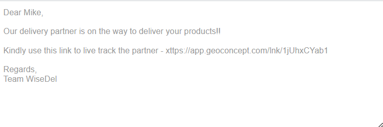

# Próxima Chegada

## 1. Introdução

O **Próxima Chegada** recurso melhorará a experiência do cliente fornecendo atualizações de status de entrega em tempo real. Ele gera automaticamente e envia um link de Hora Estimada de Chegada (ETA) ao seu cliente assim que o processo de entrega começar.

**O benefício principal é a transparência**: Quando o cliente clica neste link, ele pode **rastrear a localização ao vivo do entregador**.

## 2. Configuração Inicial

Para começar a usar este recurso, você deve primeiro navegar até **Próxima Chegada**

## 3. Explicações do Recurso com Benefícios

O recurso Próxima Chegada permite comunicação proativa, garantindo que os clientes estejam prontos para receber seus itens.

| Recurso                                 | Descrição                                                                                                                                    |
| --------------------------------------- | -------------------------------------------------------------------------------------------------------------------------------------------- |
| **Link ETA**                            | Um link contendo a hora estimada de chegada (ETA) é criado automaticamente e enviado assim que a entrega é concluída.                        |
| **Edição do Assunto do Email**          | Você pode inserir e personalizar o **assunto do email** para que os clientes saibam imediatamente o propósito da mensagem.                   |
| **Edição do Corpo da Mensagem**         | Você pode livremente **editar a mensagem** que será enviada aos seus clientes, permitindo linguagem personalizada e detalhes importantes     |
| **Tags de Personalização ($)**          | Ao digitar o **símbolo de cifrão** ($) aparecem opções que você pode inserir e editar diretamente no corpo do email, economizando seu tempo. |
| **Janela de Pré-visualização**          | Antes de salvar, você pode ver a **pré-visualização** da mensagem exata que será enviada, garantindo que pareça profissional e precisa.      |
| **Rastreamento de Localização ao Vivo** | O link permite que o cliente rastreie a localização ao vivo da entrega (ou do entregador).                                                   |
| **Email de Saída**                      | Opção para habilitar o envio do link ETA por email.                                                                                          |
| **SMS de Saída**                        | Opção para habilitar o envio do link ETA por mensagem de texto.                                                                              |

## 4. Configurando Notificações ao Cliente

Esta é a ação principal que você realizará: escolher os canais de comunicação para o link de ETA e localização ao vivo.

1. **Acesse a Configuração:** Navegue até e clique em **Próxima Chegada** (veja os passos de Configuração Inicial acima).
2. **Habilitar Comunicação por Email:** Selecione a opção para habilitar **emails de saída**.

3. **Habilitar Comunicação por SMS (Opcional):** Selecione a opção para habilitar **SMS de saída**.
4. **Inserir Informações Personalizadas (Opcional)** Para incluir informações dinâmicas (como o nome do cliente ou detalhes específicos do agendamento), digite o **símbolo de cifrão** ($). Isto mostrará opções que você pode usar para editar o corpo do email.

&#x20;      💡 **Dica:** Usar tags de personalização faz a mensagem parecer mais direta e profissional.

5. **Reveja o Conteúdo da Mensagem (Recomendado):** Para confirmar a experiência do cliente, selecione a opção para **ver a pré-visualização do email**.
6. **Salve Suas Configurações:** Uma vez satisfeito com os canais habilitados e com a pré-visualização, clique em **salvar**.

7. O cliente receberá o seguinte email.&#x20;

<figure><figcaption></figcaption></figure>

***

## 5. Dicas de Produtividade

Aqui estão algumas maneiras de maximizar a eficácia das suas comunicações de próxima chegada:

* 💡 **Comunicação por Canal Duplo:** Considere habilitar **ambos** emails de saída e SMS de saída. Usar ambos os métodos garante que o cliente receba as informações críticas de ETA independentemente de verificar primeiro a caixa de entrada ou as mensagens de texto.
* 💡 **Sempre Pré-visualize:** Use a opção para **ver a pré-visualização do email** antes de salvar as alterações de configuração. Esta é sua chance de verificar se a mensagem contém o link da localização ao vivo conforme esperado.
* ⚠️ **Entendendo os Pontos de Disparo:** Lembre-se que o link ETA é enviado _uma vez que o entregador completa a fase de entrega_ (isto é, quando eles estão a caminho do cliente). Garanta que suas definições operacionais de "completar a entrega" estejam alinhadas com o momento em que você deseja que o cliente comece a rastrear a localização ao vivo.
