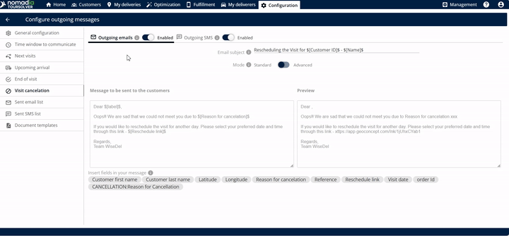
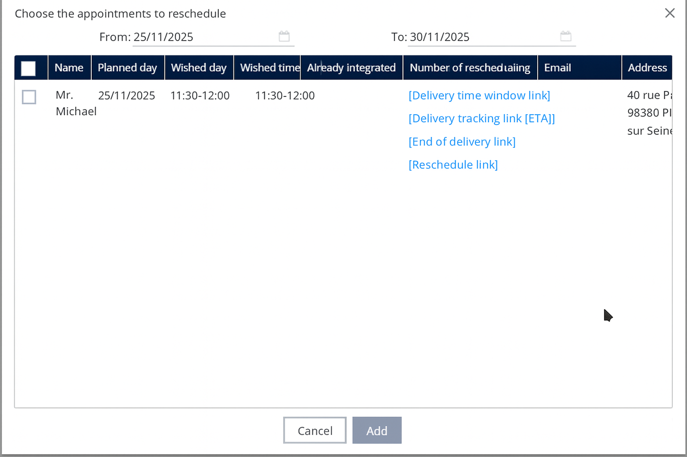

# Cancelamento de Visita

## 1. Introdução

Este processo permite marcar uma visita como cancelada enquanto simultaneamente aciona uma ação que solicita ao cliente final que selecione uma nova data e hora para reagendamento.

## 2. Configuração Inicial&#x20;

Antes de processar um cancelamento, você deve garantir que os canais de comunicação estejam ativos para que o cliente receba o link de reagendamento.

1. **Acesse as Configurações de Cancelamento:** Clique na **cancelamento de visita** opção.
2. **Ative Mensagens de Saída:** Certifique-se de que ambos os tipos de comunicação de saída estejam ativados:
   * **E-mails de saída**
   * **SMS de Saída**
3. **Defina o Assunto (E-mails e SMS):** Mencione o específico **assunto** que você quer que o cliente veja.

***

## 3. Explicação de Funcionalidades e Benefícios

Esse recurso simplifica a comunicação e a logística quando uma tentativa de entrega falha devido à indisponibilidade do cliente.

| Recurso                                 | Descrição                                                                                                                                         |
| --------------------------------------- | ------------------------------------------------------------------------------------------------------------------------------------------------- |
| **Link de ETA**                         | Um link contendo o tempo estimado de chegada (ETA) é criado automaticamente e enviado assim que a entrega for concluída.                          |
| **Edição do Assunto do E-mail**         | Você pode inserir e personalizar o **assunto do e-mail** para que os clientes saibam imediatamente o propósito da mensagem.                       |
| **Edição do Corpo da Mensagem**         | Você pode livremente **editar a mensagem** que será enviada aos seus clientes, permitindo linguagem personalizada e detalhes importantes          |
| **Tags de Personalização ($)**          | Ao inserir o **símbolo do dólar** ($) são mostradas opções que você pode inserir e editar diretamente no corpo do e-mail, economizando seu tempo. |
| **Janela de Visualização**              | Antes de salvar, você pode ver a **visualização** da mensagem exata que será enviada, garantindo que ela pareça profissional e precisa.           |
| **Rastreamento de Localização ao Vivo** | O link permite que o cliente acompanhe a localização ao vivo da entrega (ou do entregador).                                                       |
| **E-mail de Saída**                     | Opção para permitir o envio do link de ETA por e-mail.                                                                                            |
| **SMS de Saída**                        | Opção para permitir o envio do link de ETA por mensagem de texto.                                                                                 |

💡 **Dica:** O corpo do e-mail inclui automaticamente o **motivo do cancelamento** e o **data de reagendamento** informações.

**Insira Informações Personalizadas (Opcional)** Para incluir informações dinâmicas (como o nome do cliente ou detalhes específicos do agendamento), insira o **símbolo do dólar** ($). Isso mostrará opções que você pode usar para editar o corpo do e-mail.

💡 **Dica:** Usar tags de personalização faz a mensagem soar mais direta e profissional.

#### Gerenciando Compromissos Reagendados&#x20;

Após uma visita ser cancelada, o entregador deve recolocar o compromisso na agenda assim que uma nova data for selecionada.

**Localizando os Dados**

1. **Acesse o Cumprimento:** Vá para a **aba de cumprimento**.
2. **Ver Lista de Cancelados:** Clique em **para ser reagendado**.
3. **Revisar Dados:** Você pode **ver os dados reagendados aqui**.

<figure><figcaption></figcaption></figure>

**Adicionando o Compromisso de Volta à Agenda**

1. **Acesse Ferramentas do Entregador:** O entregador deve clicar em **minhas entregas**.
2. **Selecionar Compromissos:** Clique em **adicionar compromissos para reagendar**.
3. **Listar e Adicionar:** **Liste os dados aqui** e clique **adicionar**.

**Resultado Esperado:** As visitas reagendadas **serão adicionadas com sucesso à próxima simulação/otimização**.

<figure><figcaption></figcaption></figure>

## 5. Dicas de Produtividade

* **Sempre Habilite Ambos:** Para alcance máximo ao cliente, certifique-se de **ativar os e-mails de saída e os SMS de saída** ao configurar o cancelamento. Este recurso está disponível em vários canais, garantindo que os clientes possam acessá-lo mesmo se um método for perdido.
* **Use o Recurso de Visualização:** Antes de clicar **salvar**, sempre utilize o recurso para **ver a pré-visualização do email**. Isso confirma que o motivo do cancelamento e o link de reagendamento são exibidos corretamente, evitando erros de comunicação.
* **Acompanhe Itens Reagendados:** Verifique regularmente o **aba de cumprimento** em **para ser reagendado**. Isso garante que nenhuma visita cancelada seja esquecida e mantém seu fluxo de trabalho logístico atualizado.
