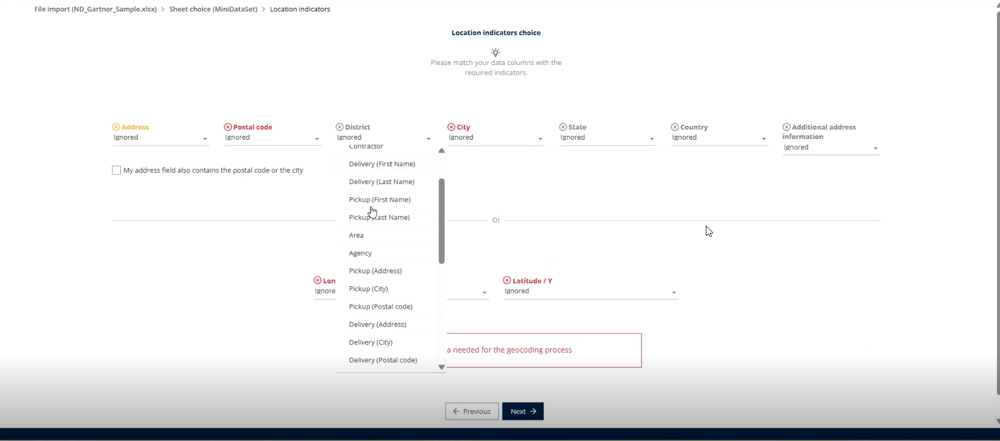

# 12. Como otimizar a geocodificação no TourSolver?

* **Forneça endereços completos e precisos**\
  Certifique-se de que cada endereço inclua o nome da rua, número, código postal, cidade e país. Dados limpos e consistentes melhoram os resultados da geocodificação.
*   **Use campos separados para cada componente do endereço**\
    O TourSolver suporta dois formatos para inserir informações de endereço:

    1. **Colunas estruturadas** – Rua, Código Postal, Cidade e País inseridos separadamente.
    2. **Campo combinado único** – Endereço completo inserido em uma coluna.

    👉 Para garantir uma geocodificação precisa, **escolha um formato e use-o de forma consistente**. Não misture colunas estruturadas com um campo combinado no mesmo conjunto de dados, pois isso pode causar erros ou inconsistências no reconhecimento de endereços.
*   **Verifique a informação do distrito**\
    Para melhorar a precisão da geocodificação, sempre **especifique o distrito correto** ao inserir dados de endereço. O TourSolver agora inclui uma **coluna Distrito**, que ajuda o sistema a restringir a busca e localizar a área correta de forma mais eficaz.

    👉 Usar o campo de distrito de forma consistente garante que os endereços sejam combinados com a zona geográfica correta e reduz erros no planejamento de rotas.

<figure><figcaption></figcaption></figure>

* **Prefira coordenadas GPS quando disponíveis**\
  Se tiver valores de latitude e longitude, inclua-os. O TourSolver usará esses valores diretamente e pulará a geocodificação por endereço, resultando em maior precisão.
* **Revise a qualidade da geocodificação após a importação**\
  Use os indicadores de qualidade de geocodificação para identificar pontos incorretos ou de baixa qualidade e corrigi-los nos dados.
*   **Opção de reposicionamento no App Móvel**\
    Para melhorar a qualidade da geocodificação, o TourSolver fornece uma **opção de Reposicionamento** no aplicativo móvel. Esse recurso permite aos usuários **atualizar ou ajustar a localização diretamente de seu dispositivo móvel**, garantindo que a posição registrada seja precisa e alinhada com o local real.

    👉 Usar a opção de reposicionamento ajuda a corrigir discrepâncias menores e melhora a precisão dos endereços geocodificados no planejamento de rotas.
