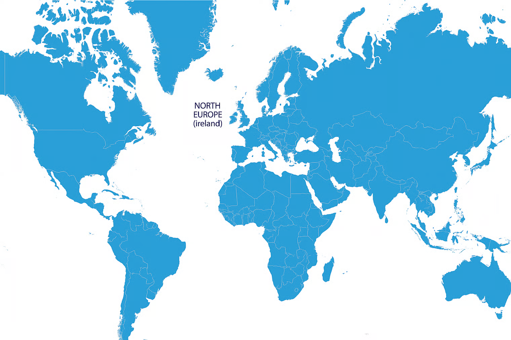

# 1. Onde meus dados estão hospedados?

Onde os seus dados e a infraestrutura necessária para usar o TourSolver são armazenados dependerá do escopo da sua cobertura geográfica e, portanto, em última instância, do país em que você está operando ao realizar otimizações de rotas.&#x20;

Para [todos os países suportados](https://www.toursolver.com/fr/faq/couverture-g%C3%A9ographique-de-toursolver) no TourSolver o hospedagem da infraestrutura em nuvem e dos seus dados será na Europa e na Irlanda do Norte.

<figure><figcaption></figcaption></figure>
