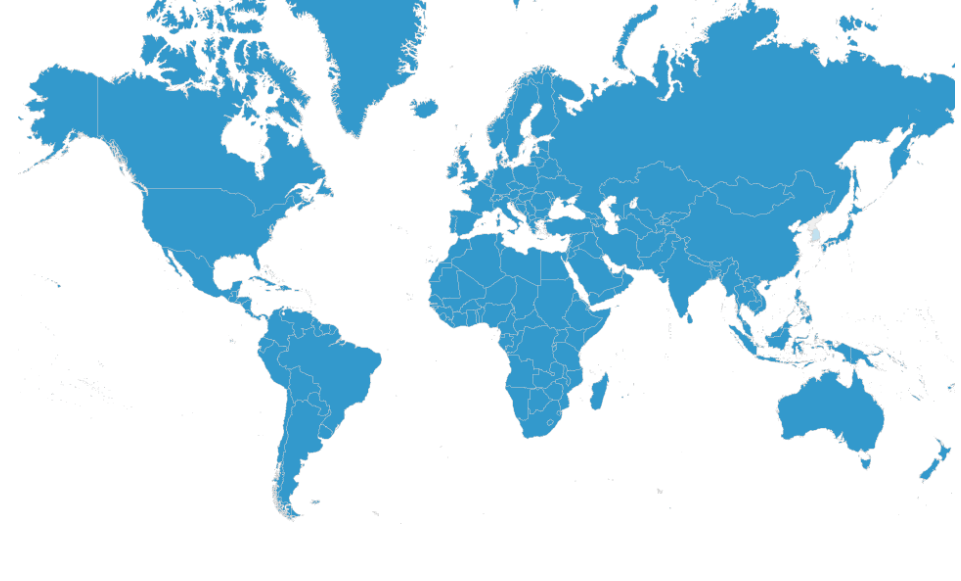

# 17. Quais países são cobertos pelo TourSolver?

A partir de **2 de maio de 2018 (versão 5.0)**, o TourSolver oferece cobertura de roteirização e otimização em **aproximadamente 230 países**, representando **mais de 7,2 bilhões de pessoas**.\
Com adições recentes como **Bangladesh, Butão, Maldivas, Nepal, Paquistão e Sri Lanka**, o TourSolver agora cobre **quase todo o planeta**.

### **🌍 Países não cobertos**

* **Coreia do Norte**
* **Coreia do Sul**

<figure><figcaption></figcaption></figure>

A cobertura está organizada por região, e algumas regiões incluem **setorização geográfica** (disponível na **versão Premium**). Abaixo está a lista completa de países cobertos e seu status de disponibilidade no Premium.

***

### **🌍 Europa**

**Setorização geográfica disponível no Premium**

ALBÂNIA, ALEMANHA, ANDORRA, ARMÊNIA, ÁUSTRIA, AZERBAIJÃO, BIELORRÚSSIA, BÉLGICA, BÓSNIA E HERZEGOVINA, BRASIL, BULGÁRIA, CHIPRE, CROÁCIA, DINAMARCA, ESPANHA, ESTÔNIA, FEDERAÇÃO RUSSA, FINLÂNDIA, FRANÇA, GEÓRGIA, GRÉCIA, GROENLÂNDIA, HUNGRIA, ILHA DE MAN, ILHAS FEROE, IRLANDA, ISLÂNDIA, ITÁLIA, CAZAQUISTÃO, QUIRGUISTÃO, LETÔNIA, LIECHTENSTEIN, LITUÂNIA, LUXEMBURGO, MALTA, MONTENEGRO, NORUEGA, UZBEQUISTÃO, PAÍSES BAIXOS, POLÔNIA, PORTUGAL, MACEDÔNIA DO NORTE, MOLDÁVIA, REPÚBLICA TCHECA, ROMÊNIA, REINO UNIDO, SÉRVIA, ESLOVÁQUIA, ESLOVÊNIA, SUÉCIA, SUÍÇA, TAJIQUISTÃO, TURCOMENISTÃO, TURQUIA, UCRÂNIA.

***

### **🌍 África e Oriente Médio**

**Setorização geográfica NÃO disponível no Premium**

Afeganistão, África do Sul, Argélia, Angola, Arábia Saudita, Bahrain, Faixa de Gaza, Benim, Botsuana, Burquina Faso, Burundi, Camarões, Cabo Verde, Comores, República Democrática do Congo, República do Congo, Costa do Marfim, Djibuti, Egito, Emirados Árabes Unidos, Eritreia, Etiópia, Gabão, Gâmbia, Gana, Guiné, Guiné Equatorial, Guiné-Bissau, Iraque, Irã, Israel, Jordânia, Quênia, Kuwait, Lesoto, Líbano, Libéria, Líbia, Madagascar, Maláui, Mali, Marrocos, Maurício, Mauritânia, Mayotte, Moçambique, Namíbia, Níger, Nigéria, Omã, Uganda, Palestina, Catar, República Centro-Africana, Reunião, Ruanda, Saara Ocidental, São Tomé e Príncipe, Senegal, Seychelles, Serra Leoa, Somália, Sudão, Sudão do Sul, Santa Helena–Ascensão–Tristão da Cunha, Essuatíni (Suazilândia), Síria, Tanzânia, Chade, Togo, Tunísia, Iêmen, Zâmbia, Zimbábue.

***

### **🌍 América do Norte e Central**

**Setorização geográfica disponível no Premium**

Bahamas, Belize, Bermudas, Canadá, Costa Rica, Cuba, Ilhas Cayman, República Dominicana, Guatemala, Honduras, Haiti, Jamaica, México, Nicarágua, Panamá, Porto Rico, El Salvador, São Pedro e Miquelão, Ilhas Turks e Caicos, Estados Unidos, Ilhas Virgens Britânicas, Ilhas Virgens Americanas.

***

### **🌍 América do Sul e Caribe**

**Setorização geográfica NÃO disponível no Premium**

Aruba, Anguilla, Argentina, Antígua e Barbuda, São Eustáquio, Saba, Bonaire, Saint-Barthélemy, Bolívia, Brasil, Barbados, Chile, Colômbia, Curaçao, Dominica, Equador, Ilhas Malvinas, Guadalupe, Granada, Guiana, Guiana Francesa, São Cristóvão e Nevis, Santa Lúcia, Saint-Martin, Montserrat, Martinica, Peru, Paraguai, Geórgia do Sul e Ilhas Sandwich do Sul, Suriname, Sint Maarten, Trinidad e Tobago, Uruguai, São Vicente e Granadinas, Venezuela.

***

### **🌍 Ásia**

**Setorização geográfica NÃO disponível no Premium**

Bangladesh, Butão, China _(disponível apenas dentro da China)_, Índia, Maldivas, Nepal, Paquistão, Sri Lanka, Japão.

***

### **🌍 Sudeste Asiático**

**Setorização geográfica NÃO disponível no Premium**

Brunei, Guam, Hong Kong, Indonésia, Camboja, Laos, Macau, Mianmar, Mongólia, Ilhas Marianas, Malásia, Filipinas, Ilhas Paracel, Palau, Papua-Nova Guiné, Singapura, Ilhas Salomão, Ilhas Spratly, Tailândia, Timor-Leste, Vietnã, Taiwan.

***

### **🌍 Oceania**

**Setorização geográfica NÃO disponível no Premium**

Austrália, Micronésia, Fiji, Ilhas Cook, Ilhas Marshall, Quiribati, Nauru, Niue, Nova Caledônia, Nova Zelândia, Polinésia Francesa, Samoa, Samoa Americana, Tokelau, Tonga, Tuvalu, Vanuatu, Wallis e Futuna.
