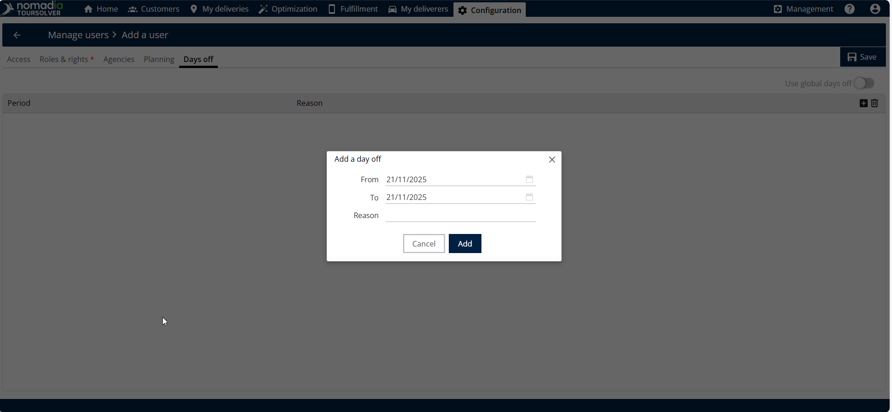

# Criar e Modificar um Usuário

## 1. Introdução

Este guia fornece instruções passo a passo para configurar novos membros da equipe e atualizar os detalhes, funções ou horários de usuários atuais. Seguindo estes passos simples, você poderá gerenciar as configurações de acesso com confiança e eficiência!

## 2. Configuração Inicial

O primeiro passo para criar ou modificar qualquer usuário é acessar a área principal de configuração a partir da página inicial.

Para começar a criar ou modificar um usuário, siga estes passos:

1. A partir da **página inicial**, vá para a **configuração.**
2. Clique em **Gerenciar Usuários.**

<figure><figcaption></figcaption></figure>

<figure><figcaption></figcaption></figure>

3. Clique em **menu Ações**.
4. Clique em **Adicionar**

<figure><figcaption></figcaption></figure>

## 3. Explicação de Funcionalidades e Benefícios

Ao criar ou modificar um usuário, você interagirá com várias seções-chave para definir seu acesso e agendamento.

| Seção                    | Propósito (Contexto)                                                                                     | Ações Principais                                                                     |
| ------------------------ | -------------------------------------------------------------------------------------------------------- | ------------------------------------------------------------------------------------ |
| **Acesso**               | Define a identidade básica e as permissões de login (web e móvel) para o usuário.                        | Digite o ID de login, nomes e defina a senha inicial para o usuário móvel            |
| **Funções e Permissões** | Determina o que o usuário pode ver e fazer dentro da aplicação (por exemplo, administrador, otimização). | Ative as funções e permissões necessárias, como **administrador** ou **otimização**. |
| **Agências**             | Atribui as agências específicas pelas quais o usuário é responsável ou às quais precisa ter acesso.      | Selecione as agências necessárias e use o **seta direita** para atribuí-las.         |
| **Planejamento**         | Permite planejar o horário de slot para o usuário.                                                       | Toque no dia e horário para definir o horário de slot, depois toque **atualizar**.   |
| **Dias de Folga**        | Permite pré-planejar e registrar quaisquer dias de folga que o usuário pretenda tirar.                   | Digite o **data de início** e **até a data** para o período de folga planejado.      |

**Observação**: Planejamento e dias de folga serão acessíveis apenas ao usuário móvel. Funções e permissões serão acessíveis apenas ao usuário web

## 4. Criação de Usuários

Você pode criar um usuário completamente do zero ou modificar eficientemente um usuário existente usando seus dados como modelo.

### Criar um Usuário do Zero

Isto é necessário ao integrar um novo funcionário que requer um ID de login único e funções definidas.

1. Após navegar até a tela Adicionar, confirme que você está criando um usuário do zero.
2. Primeiro, vejamos como criar o usuário do zero. Clique em **OK** – Inicia a criação de um novo usuário.

<figure><figcaption></figcaption></figure>

<figure><figcaption></figcaption></figure>

3. Preencha os Detalhes de Acesso: Na seção Acesso, insira as informações exigidas: **ID de Login, Nome e Sobrenome**
4. Defina **Tipo de Acesso** e **Senha:** Para acesso web, alterne a opção Acesso Web, e para acesso móvel, alterne a opção Acesso Móvel.
5. Digite o **senha**

**Dica**: Você pode alternar as opções Acesso Web e Acesso Móvel ao mesmo tempo se o usuário precisar de ambos. ⚠ Aviso (Requisito de Senha): a senha deve conter 8 caracteres, incluindo um caractere numérico e um caractere especial.

<figure><figcaption></figcaption></figure>

<figure><figcaption></figcaption></figure>

6. **Definir Funções e Permissões**: Na seção Funções e Permissões, ative todas as funções necessárias, como administrador, otimização ou depósito.&#x20;
7. **Atribuir Agências**: Na seção Agências, clique nas agências que você precisa atribuir e então clique na seta direita para movê-las para a lista atribuída.

<figure><figcaption></figcaption></figure>

<figure><figcaption></figcaption></figure>

8. **Planejar Horário de Slot**: Na seção Planejamento, clique no dia e horário para definir o horário de slot desejado e então clique em atualizar.

<figure><figcaption></figcaption></figure>

<figure><figcaption></figcaption></figure>

**Agendar Dias de Folga (Opcional): Na seção Dias de Folga, você pode planejar períodos futuros de folga:**

9. Clique na **símbolo de mais** ícone no lado direito.
10. Digite o **data de início** e o **até a data** para o dia de folga.
11. Clique em **Adicionar**

<figure><figcaption></figcaption></figure>

<figure><figcaption></figcaption></figure>

12. **Salvar o Usuário**: Após preencher todas as informações necessárias, clique em **Salvar** para finalizar a criação.

<figure><figcaption></figcaption></figure>

<figure><figcaption></figcaption></figure>

**Resultado&#x20;**_**Esperado**:_ O usuário foi criado com sucesso

<figure><figcaption></figcaption></figure>

### Modificar um Usuário Existente

Você pode atualizar facilmente as informações de um usuário existente, como suas funções, agências ou cronograma, sem começar do zero.

1. **Selecionar Usuário Existente:** Ative Sim na seção criar a partir de um usuário existente.
2. **Escolher o Usuário**: Selecione o usuário específico que deseja modificar e então clique em **OK**.

<figure><figcaption></figcaption></figure>

3. **Modificar Informações**: Todas as informações do usuário serão copiadas automaticamente do usuário selecionado. Revise as diferentes seções (Acesso, Funções e Permissões, Planejamento, etc.) e modifique as informações existentes conforme necessário.
4. **Salvar Alterações:** Depois de atualizar as informações necessárias, clique em Salvar para concluir a modificação.

<figure><figcaption></figcaption></figure>

<figure><figcaption></figcaption></figure>

## 5. Dicas de Produtividade

Aqui estão algumas dicas e avisos úteis para garantir que seu processo de gerenciamento de usuários ocorra sem problemas:

* 💡 **Acesso Duplo:** Lembre-se de que você pode ativar tanto o **acesso web** e **acesso móvel** simultaneamente para um usuário, dando-lhe flexibilidade na forma como ele interage com o sistema.
* ⚠️ **Clareza da Senha:** Ao definir uma senha, certifique-se de que ela atenda aos critérios de segurança: ela deve ter **8 caracteres** de comprimento e incluir pelo menos **um numérico** caractere e **um caractere especial**.
* ⚠️ **Evite Emails Duplicados:** Se você tentar inserir um endereço de e-mail que já está sendo usado por outro usuário, o sistema exibirá uma mensagem de erro informando que **"o id de e-mail já está sendo usado"**. Você precisará usar um endereço de e-mail único para prosseguir.
