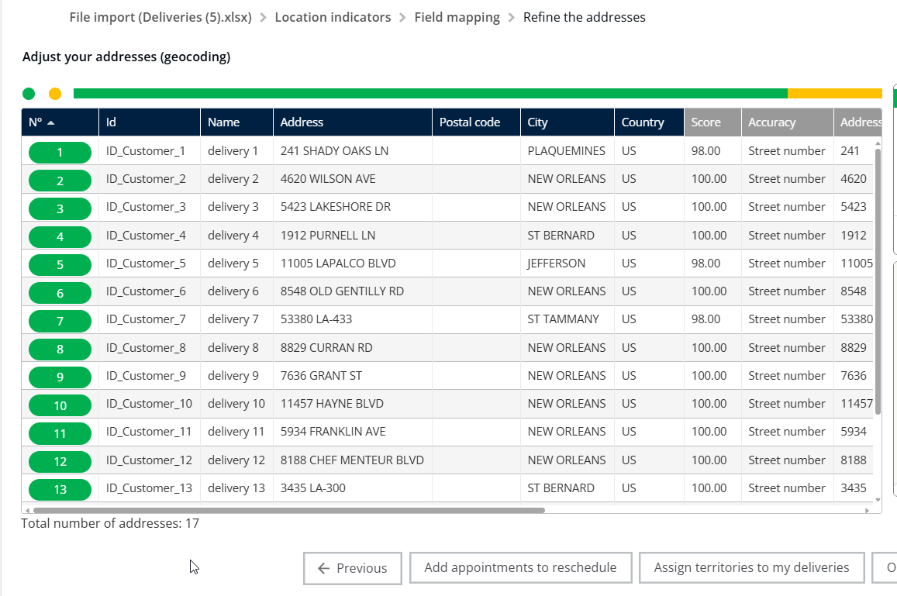

# Importação de Entregas

## 1. Introdução

Bem-vindo! Este guia foi concebido para tornar a importação dos seus dados de entrega para o servidor uma experiência fácil e bem-sucedida.

A Importação de Entregas permite que você carregue uma lista de endereços e informações de clientes diretamente no sistema para visualização e otimização de rotas. Seguindo estes passos simples, você associará as colunas da sua planilha aos campos exigidos pelo sistema, visualizará os locais num mapa e começará a otimizar suas rotas de entrega.

***

## 2. Configuração Inicial

#### Acessando Minhas Entregas

Para começar a importar suas entregas, você precisa primeiro navegar:

1. Do menu principal para **Minhas Entregas**.
2. Você agora está pronto para importar seus **Dados.**

#### Baixando Dados de Exemplo

Se você não tem certeza de como formatar seu arquivo Excel, pode baixar um modelo de exemplo. Usar os dados de exemplo garante que seu arquivo esteja pronto para importação imediatamente.

1. Clique em **Baixar**.
2. O arquivo Excel contendo dados de exemplo será baixado.

<figure><figcaption></figcaption></figure>

<figure><figcaption></figcaption></figure>

💡 **Dica** : Use sempre os dados de exemplo fornecidos se você for novo na estrutura do sistema. Isso frequentemente reduz possíveis erros de mapeamento mais tarde!

***

## 3. Explicações de Recursos com Benefícios

O processo de importação inclui várias etapas-chave que ajudam a garantir que seus dados estejam preparados com precisão para o planejamento de rotas:

| Recurso                     | Contexto e Benefício                                                                                                                                                                                                                     |
| --------------------------- | ---------------------------------------------------------------------------------------------------------------------------------------------------------------------------------------------------------------------------------------- |
| **Mapeamento de Dados**     | Isto garante que os cabeçalhos das colunas na sua planilha carregada (como "Cust ID" ou "Nome do Cliente") estejam corretamente associados aos campos usados pelo servidor. Esse casamento preciso é crucial para um roteamento preciso. |
| **Cores de Geocodificação** | Após a importação, o sistema tenta automaticamente encontrar a localização precisa (geocodificar) de cada endereço de entrega. As cores indicam sucesso ou falha, permitindo que você identifique e corrija rapidamente os erros.        |
| **Otimização de Rotas**     | Esta é a etapa final onde o sistema calcula a ordem e o trajeto mais eficiente para suas entregas importadas.                                                                                                                            |

## 4. Importando Entregas e Otimizando Rotas

Esta tarefa abrange o processo de carregar seus dados de entrega, verificar o mapeamento dos campos e iniciar o planejamento de rotas.

#### Importando Dados e Mapeando Campos

Você precisa informar ao sistema quais colunas da sua planilha correspondem aos campos do sistema (como ID do Cliente ou Nome).

1. Clique em **importar** para iniciar o processo de importação dos seus dados de entrega para o servidor

<figure><figcaption></figcaption></figure>

2. Uma janela de mapeamento aparecerá, solicitando que você associe seus campos do Excel com os campos exigidos pelo servidor.
3. Se um campo já estiver corretamente mapeado (como acontece se você usar o modelo), você pode pular o mapeamento para esse campo.

**Para redefinir ou ajustar um mapeamento de campo (usando ID do Cliente e Nome como exemplo):**

4. Se um campo estiver atualmente mapeado, você pode optar por ignorá-lo.
5. Clique em _ignorado_ para mapear o campo para uma restrição diferente do TourSolver.

<figure><figcaption></figcaption></figure>

<figure><figcaption></figcaption></figure>

6. Clique em **mostrar tudo** para visualizar todas as opções possíveis de campo.

<figure><figcaption></figcaption></figure>

7. Clique no **ID do Cliente** opção para mapeá-lo.

<figure><figcaption></figcaption></figure>

8. Se precisar alterar o campo Nome, clique em ignorar sob o mapeamento de nome atual.

<figure><figcaption></figcaption></figure>

9. Clique em **Nome** para completar o mapeamento do campo nome

<figure><figcaption></figcaption></figure>

#### Revisando Dados e Resultados de Geocodificação

Após confirmar o mapeamento dos dados, você pode prosseguir para a visualização do mapa para revisar os resultados da geocodificação.

1. Clique em **Próximo** uma vez que o mapeamento esteja completo

<figure><figcaption></figcaption></figure>

2. A visualização do mapa aparecerá, exibindo seus locais com as cores de geocodificação

<figure><figcaption></figcaption></figure>

3. Revise o **locais** e suas **cores**.
4. Se você vir locais em cinza, esses endereços não foram encontrados pelo sistema. Pode ser necessário revisar e corrigir esses endereços nos seus dados originais antes de otimizar a rota para maior precisão

<figure><figcaption></figcaption></figure>

5. Clique em **Otimizar minhas rotas** para iniciar o cálculo da rota

<figure><figcaption></figcaption></figure>

6. Uma vez que você **inicie a otimização**, o sistema começará o processo de cálculo.

<figure><figcaption></figcaption></figure>

## 5. Entendendo o Status da Geocodificação

Quando a visualização do mapa aparecer, as cores o guiarão para entender se seus endereços foram localizados com sucesso (geocodificados):

* **Cor amarela** indica que a localização foi geocodificada com sucesso ao nível da rua.

<figure><figcaption></figcaption></figure>

* Cor verde indica que a localização foi geocodificada com sucesso ao nível do edifício.

<figure><figcaption></figcaption></figure>

<figure><figcaption></figcaption></figure>

* **Cor cinza** indica que a localização não foi geocodificada.

<figure><figcaption></figcaption></figure>

<figure><figcaption></figcaption></figure>

***

## 6. Dicas de Produtividade

Aqui estão algumas maneiras de tornar sua importação de dados mais rápida e precisa:

* 💡 **Priorize o Amarelo:** Ao revisar a visualização do mapa, você sabe que locais amarelos são confiáveis (geocodificados nas ruas). Concentre sua atenção em quaisquer locais marcados **Cinza**.
* 💡 **Domine a Eficiência do Mapeamento:** Se você precisar alterar rapidamente como um campo está associado, lembre-se de que pode optar por **ignorar** o mapeamento atual e então selecionar imediatamente o nome de campo correto. Isso é mais rápido do que corrigir os dados na sua planilha fora do sistema.
