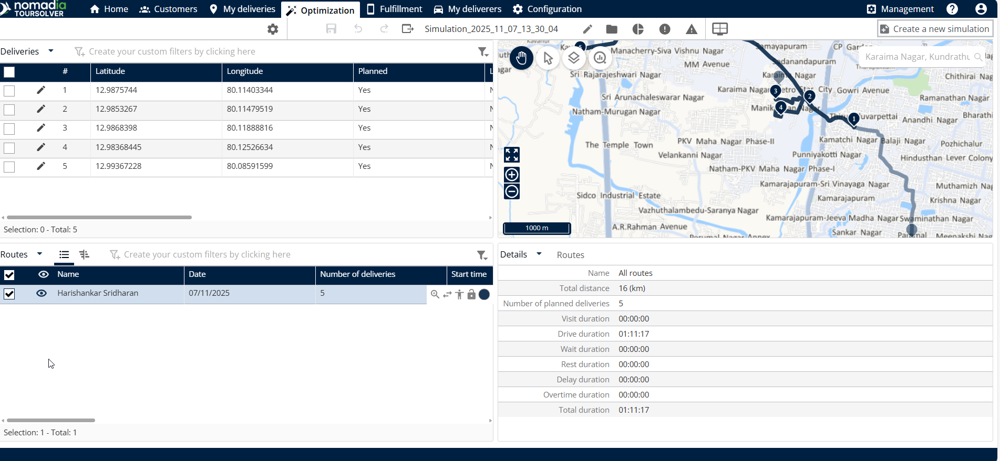
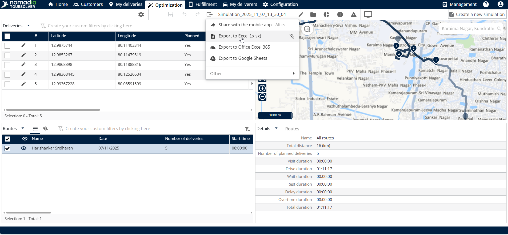
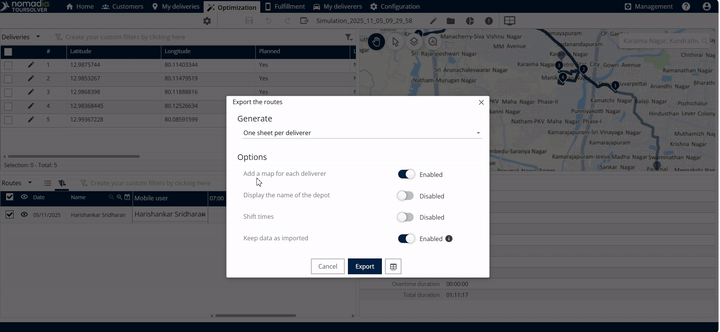
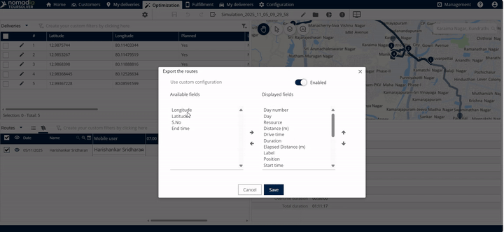
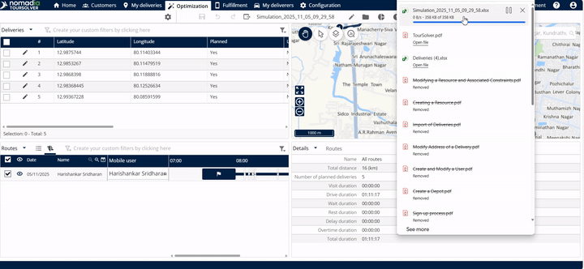
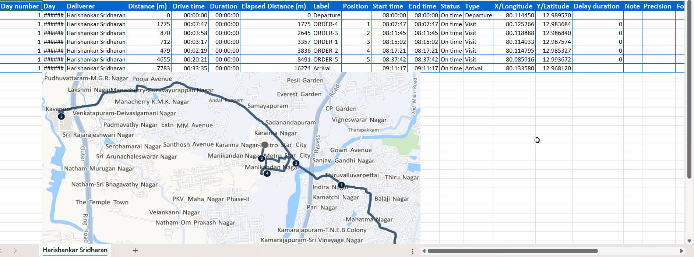

# Exportar minhas Rotas

## 1. Introdução

Este guia ensinará como selecionar, personalizar e exportar suas rotas concluídas usando o sistema de gerenciamento de rotas. Seja para compartilhar resultados com um membro da equipe via Excel ou integrar os dados em um calendário, este processo foi projetado para ser simples e eficaz.

## 2. Configuração Inicial

**Personalizando suas configurações de exportação para Excel**

Ao escolher exportar para Excel, o sistema fornece várias opções para ajustar o arquivo resultante.

1.  **Selecione o layout da sua planilha:** Escolha como os dados da rota são organizados:

    * **Uma planilha para todos os entregadores**.
    * **Uma planilha por entregador**.
    * _**Contexto**:_ Isso ajuda a decidir se você deseja uma visão consolidada ou relatórios detalhados para membros individuais da equipe.

    
<figure><figcaption></figcaption></figure>

💡 **Dica:** Essas configurações aplicam-se apenas à opção de exportação para Excel. Outros formatos (como PowerPoint ou Calendário) usarão suas configurações de saída padrão.

2. **Selecionando campos personalizados (colunas)**

Você pode escolher quais colunas específicas (campos) aparecem no arquivo exportado.

1. Clique em **outro** dentro da janela de configuração.
2. Você verá uma lista de **campos disponíveis** e **campos de exibição**.

<figure><figcaption></figcaption></figure>

3. Você também pode **ativar a configuração personalizada** se necessário.

* _Contexto:_ Quando terminar, o arquivo de exportação conterá tanto **colunas padrão quanto mapeadas**.

4. Clique em **Salvar** quando você terminar de personalizar os campos.

***

## 3. Explicação de Funcionalidades e Benefícios

O principal benefício do recurso de exportação de rotas é sua flexibilidade, permitindo compartilhar dados rapidamente em formatos adequados para vários interessados.

#### Diversos destinos de exportação

Clicando no **opção de exportação** e selecionando **outro**, você desbloqueia uma ampla variedade de tipos de exportação.

| Recurso de exportação                                                | Benefício/Utilidade                                                                                                           |
| -------------------------------------------------------------------- | ----------------------------------------------------------------------------------------------------------------------------- |
| **Exportar para Excel**                                              | Ideal para análise detalhada de dados, cálculos e relatórios estruturados.                                                    |
| **Exportar para PowerPoint / Office 365 PowerPoint / Google Slides** | Útil para gerar rapidamente apresentações ou resumos para reuniões.                                                           |
| **Exportar para Calendário (Office Outlook / Google)**               | Permite que cronogramas e horários de rotas sejam integrados diretamente em calendários pessoais ou de equipe.                |
| **Exportar um resumo das rotas enviado por e-mail**                  | Compartilha de forma eficiente uma visão geral de alto nível do plano de rotas com os destinatários.                          |
| **Exportar para Masternaut .GPX / .GPX estendido**                   | Necessário para uso com sistemas de navegação GPS específicos ou software de mapeamento avançado.                             |
| **Exportar para formato KML Google etc.**                            | Formato padrão para visualização de dados geoespaciais (como rotas) em ferramentas de mapeamento (por exemplo, Google Earth). |
| **Exportar para Webhook**                                            | Facilita a transferência automatizada de dados para outros sistemas operacionais.                                             |

## 4. Exportando uma rota para Excel

Esta é a tarefa mais comum e inclui selecionar a rota, escolher o destino, configurar as opções e finalizar o download.

Siga estes passos para exportar com sucesso a rota selecionada:

**Localizar a seção de Otimização**

1. Comece a partir da **página inicial**. Clique em Otimização

**Selecionar a rota**

2. **Clique na rota** que você deseja exportar.

<figure><figcaption></figcaption></figure>

3. **Iniciar a caixa de diálogo de exportação**

**Escolher o formato Excel**

4. Como você deseja exportar os dados para o Excel, clique em **exportar para Excel**.

<figure><figcaption></figcaption></figure>

**Configurar e gerar o arquivo**

5. Revise e ajuste suas configurações iniciais (Layout da planilha, Horários, Integridade dos dados) conforme descrito na Seção 2.

<figure><figcaption></figcaption></figure>

6. Se você personalizou campos, certifique-se de que clicou **Salvar**.

<figure><figcaption></figcaption></figure>

**Finalizar exportação e abrir o arquivo**

7. Clique na **arquivo baixado** para abri-lo

<figure><figcaption></figcaption></figure>

8. Por favor, encontre o **arquivo excel baixado** abaixo.

<figure><figcaption></figcaption></figure>

***

## 5. Dicas de Produtividade

Aqui estão algumas maneiras de tornar o processo de exportação de rotas mais eficiente:

* **Personalize colunas para eficiência (filtragem de dados):** Se você precisa apenas de dois ou três pontos de dados específicos para uma análise rápida, use a **outro** opção no menu de configuração para remover campos desnecessários. Isso mantém seu relatório limpo e focado, garantindo que o arquivo de exportação contenha apenas **colunas padrão quanto mapeadas** que mais importam.
* **Use a exportação para Calendário para agendamento:** Em vez de exportar dados complexos, use a **opção exportar para calendário** para (Office Outlook ou Google) fornecer rapidamente aos entregadores os horários finais dos turnos e os compromissos das rotas, simplificando a logística diária.
* **Economize tempo de configuração:** Depois de definir o layout da planilha desejado e as seleções de campos (como gerar **uma planilha por entregador** ou incluir **horários de turno**), clique em **Salvar**. Isso permite executar rapidamente a exportação no futuro sem reselecionar todas as configurações detalhadas.
