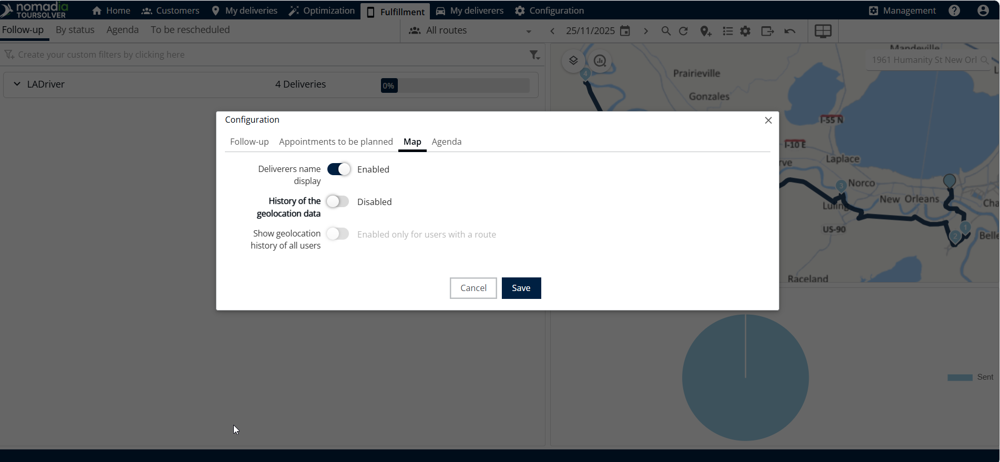

# Como eu Geolocalizo minhas Pessoas de Entrega

## 1. Introdução

Ser capaz de localizar sua equipa de entrega em tempo real é crucial para a gestão eficaz dos recursos. Este guia simplifica o processo de habilitar o acesso necessário e configurar as definições da aplicação móvel para que possa acompanhar facilmente as suas pessoas de entrega.

## 2. Configuração Inicial

Antes de começar, o sistema assume que já configurou as pessoas de entrega e as suas rotas planeadas. Se estes passos não estiverem completos, deve primeiro criar a entrega, as pessoas de entrega e a rota.

### Requisitos do Sistema (Configuração de Acesso)

Para garantir um rastreamento bem-sucedido, o seu pessoal de entrega deve ter as permissões e o acesso corretos habilitados tanto na plataforma web quanto na aplicação móvel.

**Ação Pré-requisito**

| Tipo de Acesso                           | Descrição                                                            |
| ---------------------------------------- | -------------------------------------------------------------------- |
| **Configuração do Entregador e da Rota** | A pessoa de entrega e a sua rota atribuída devem já estar criadas.   |
| **Acesso Web**                           | Necessário para login no sistema.                                    |
| **Acesso Móvel**                         | Necessário para usar a aplicação móvel, que facilita o rastreamento. |

## 3. Explicação de Funcionalidades e Benefícios

O sistema oferece funcionalidades chave que ajudam a gerir segurança, permissões e visibilidade de rastreamento:

* **Gestão de Funções e Direitos**: É aqui que concede às suas pessoas de entrega as permissões necessárias para operar no sistema.
* **Configuração da App Móvel**: Esta secção permite afinar como a aplicação móvel comunica com o sistema, incluindo a velocidade de sincronização e a visibilidade da agenda.
* **Definições de Privacidade**(**Conformidade com o RGPD**): Tem o poder de limitar quando o rastreamento ocorre, aderindo às regras de privacidade de dados. Isto cria confiança e garante conformidade legal ao restringir o rastreamento por geolocalização apenas às horas e dias de trabalho.

## 4. Ativar o Rastreamento por Geolocalização

### Configurar a App Móvel

**Editar definições gerais.**&#x20;

1. Número de dias acessíveis na agenda
2. Frequência de sincronização automática
3. Mostrar informação do tempo de deslocação

4. **Definir Regras de Privacidade**: Na configuração da aplicação móvel, habilite a privacidade de acordo com as regras relevantes (como o RGPD).

⚠ **Aviso**: Se estiver a operar numa região com leis de privacidade de dados rigorosas (como o RGPD), certifique-se de ativar o rastreamento apenas durante as horas e dias de trabalho para manter a conformidade.

### Visualizar Geolocalização na Aba de Cumprimento

1. Uma vez concluída a configuração, pode aceder à vista de rastreamento na Aba de Cumprimento
2. **Selecionar Data**: Introduza a data específica que foi agendada para a rota que pretende rastrear.

>)

3. **Abrir Definições de Exibição**: Clique em **definições**.
4. **Modificar Vista de Rastreamento**: Aqui pode ajustar como a informação de rastreamento é apresentada: **Campos disponíveis, Campos a exibir, Compromissos a planear, Mapa e Agenda**

<figure><figcaption></figcaption></figure>

3. Clique no mapa para ativar e exibir o histórico de geolocalização.

<figure><figcaption></figcaption></figure>

## 5. Dicas de Produtividade

Aqui estão algumas dicas para maximizar o uso da funcionalidade de rastreamento:

* **Personalize a Sua Vista**: Use o menu de definições na aba de Cumprimento para modificar o que vê no ecrã. Se precisar apenas do rastreamento de localização, certifique-se de que a **mapa** e **agenda** exibições estão ativadas.
* **Monitorizar o Tempo de Deslocação**: Assegure-se de rever a configuração da aplicação móvel para **mostrar informação do tempo de deslocação**. Isto ajuda a prever com precisão os horários de chegada e a gerir expectativas.
* **Manter a Sincronização Frequente**: Se o rastreamento em tempo real for crítico, verifique a **definição de frequência de sincronização automática** na configuração da aplicação móvel. Uma frequência maior fornece atualizações de localização mais imediatas.
