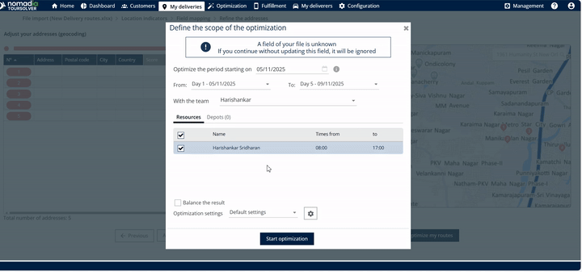
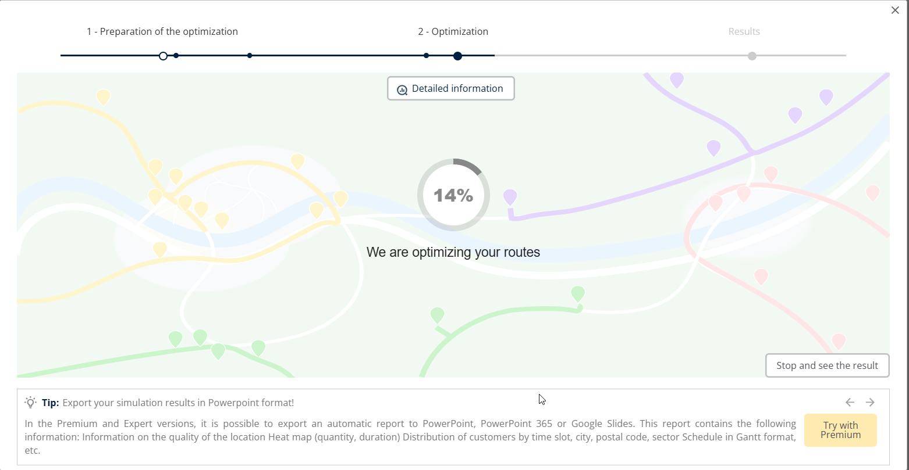
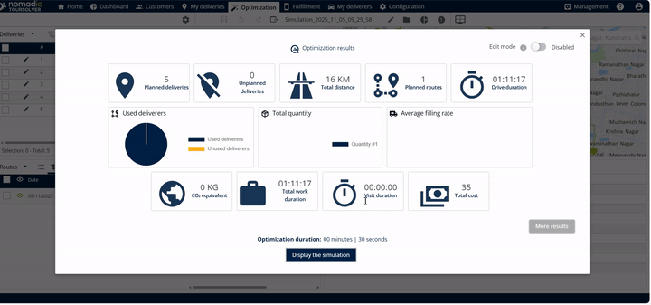
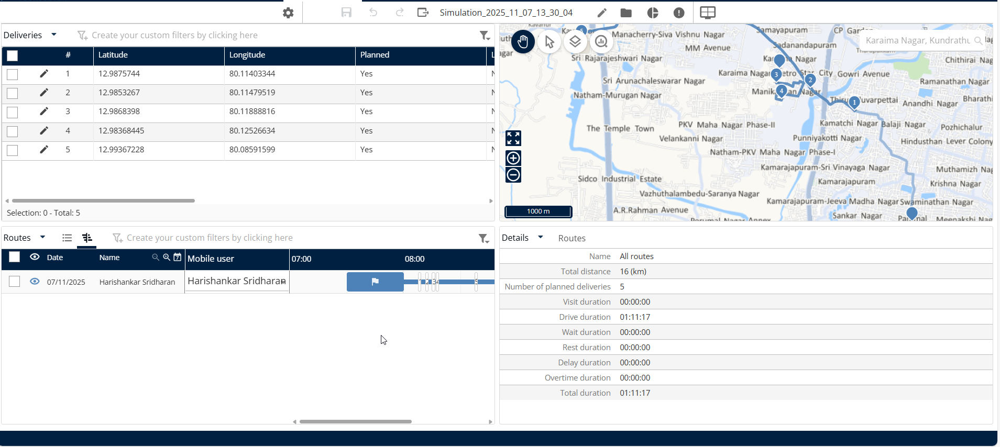
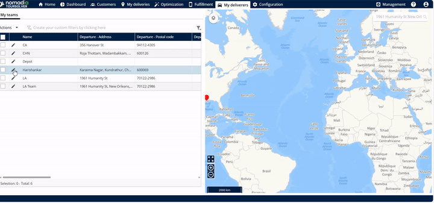
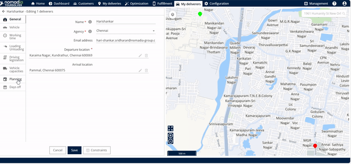
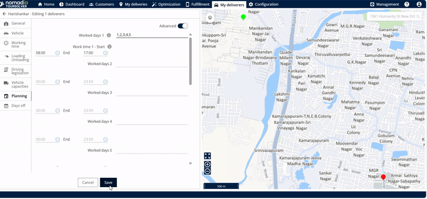

# Otimize suas Entregas

## 1. Introdução

O **Otimize suas Entregas** o recurso simplifica suas operações calculando a melhor sequência e rotas de entrega possíveis. Usando este guia, você aprenderá a definir suas preferências de otimização e a iniciar com sucesso o processo de planejamento de rotas.

***

## 2. Configuração Inicial

Para começar a usar o recurso de otimização, presume-se que você já importou seus dados de entrega para o sistema.

Antes de poder começar a otimizar, você deve navegar até o ponto de partida do processo.

1. Navegar para **Minhas Entregas**.
2. Depois de garantir que as entregas foram importadas, clique em **Próximo**.
3. Clique em **Otimizar Minhas Rotas**.

***

## 3. Explicações e Benefícios do Recurso

O **Otimize suas Entregas** oferece dois recursos principais de personalização que lhe dão controle sobre como as rotas são planejadas:

* **Otimização de Rotas:** Esta função principal pega todas as suas entregas importadas e calcula o cronograma de rotas mais eficiente.
  * **Benefício:** Entregas otimizadas com sucesso, garantindo uso eficiente do tempo e dos recursos.
* **Datas de Otimização Editáveis:** Você pode especificar exatamente quando as rotas otimizadas devem começar a ser executadas inserindo ou editando a data de início e a data de término.
* **Dias de Planejamento Editáveis:** Você tem a capacidade de ajustar o número de dias que o sistema deve planejar. Isso é útil se suas necessidades operacionais mudarem.

## 4. Iniciando a Otimização de Rotas

Esta tarefa orienta você na seleção do período de tempo e no lançamento do processo de cálculo de rotas.

1. **Defina o Intervalo de Datas de Otimização:** Na tela de otimização, insira ou edite a data de início e a data de término desejadas para as rotas otimizadas.
2. **Edite o Número de Dias (Opcional):** Se necessário, você pode ajustar o número de dias de planejamento diretamente nesta tela.

<figure><figcaption></figcaption></figure>

3. Clique em **Iniciar Otimização**

<figure><figcaption></figcaption></figure>

#### Visualizando Resultados da Otimização

1. Clique em Iniciar Otimização

<figure><figcaption></figcaption></figure>

2. Uma vez que a otimização estiver em execução, você pode monitorar os resultados.

<figure><figcaption></figcaption></figure>

**Revisar Resultados:** Você verá o resumo do resultado da otimização.

3. Clique em **Exibir a Simulação**

<figure><figcaption></figcaption></figure>

4. As entregas foram otimizadas com sucesso.

<figure><figcaption></figcaption></figure>

#### Ajustando o Período de Planejamento (Número de Dias)

Se você precisar alterar por quantos dias o sistema deve planejar rotas, você pode configurar essa opção dentro de **Meus Entregadores**.

1. Ir para **Meus Entregadores**
2. Localize o recurso associado à entrega.

<figure><figcaption></figcaption></figure>

3. Clique em **Planejamento**

<figure><figcaption></figcaption></figure>

3. **Editar Dias:** Altere o valor para o novo número de dias que você deseja usar para o planejamento.
4. Clique em **Salvar**

<figure><figcaption></figcaption></figure>

## 5. Dicas de Produtividade

* ⏳ **Dica: Tenha Paciência com Trabalhos Grandes:** Se você tiver muitas entregas que precisam de otimização, o processo pode demorar mais do que o esperado. Isso é normal porque o sistema está realizando cálculos complexos.
* ✅ **Dica: Verifique os Resultados Cedo:** Você nem sempre precisa esperar que todo o processo termine. Se precisar de um resultado preliminar rapidamente, você pode clicar em **Parar e ver o resultado** a qualquer momento durante o cálculo.
* 🎉 **Confirmação de Sucesso:** Uma vez que o sistema confirme que "As entregas foram otimizadas com sucesso", você saberá que suas novas rotas estão prontas para serem implementadas.
