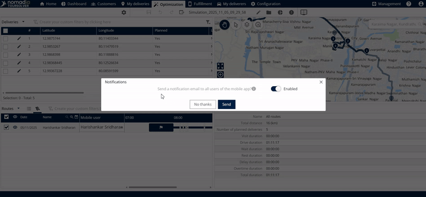
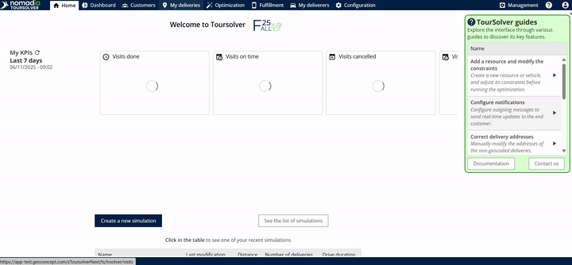
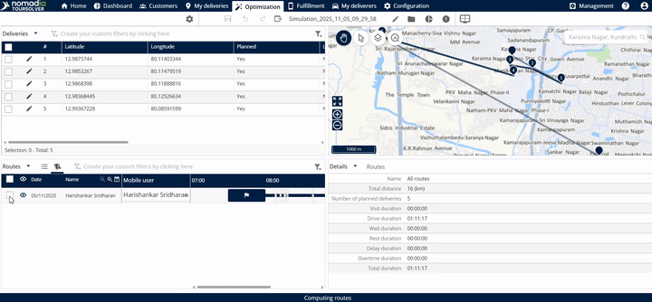
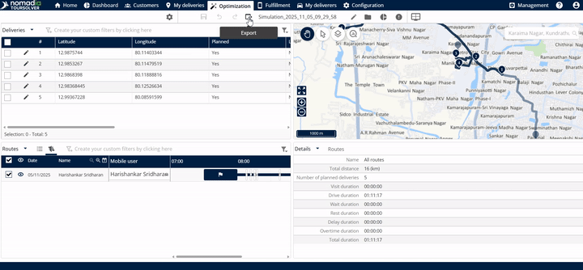
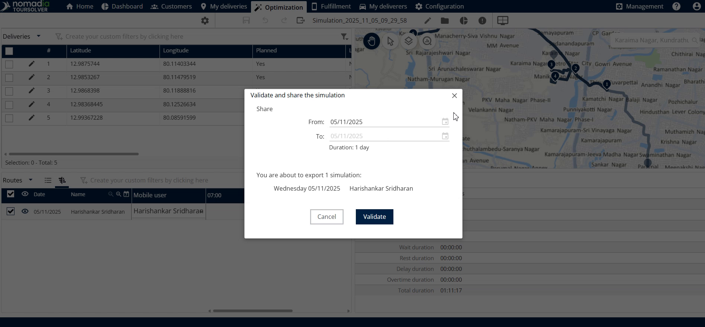
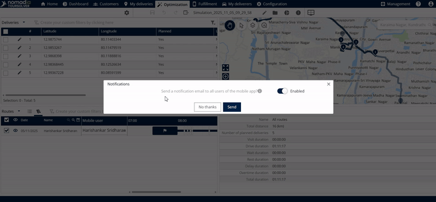
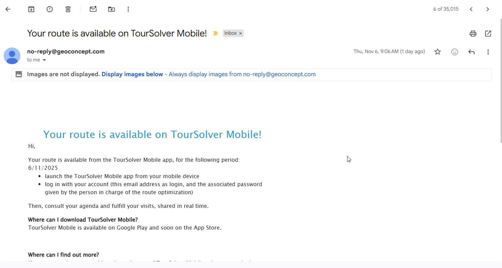

# Compartilhar um Percurso com o Aplicativo Móvel

## 1. Introdução

Este guia orienta você pelo processo de exportação de uma rota planejada para o aplicativo móvel usado pela sua equipe de campo. Esse processo garante que os usuários móveis recebam uma notificação por e-mail ou SMS contendo a rota compartilhada e suas entregas associadas.

## 2. Configuração Inicial

Para compartilhar uma rota com sucesso, você deve primeiro acessar a seção de otimização e selecionar uma rota concluída.

| Tipo de Conta           | Notificação Enviada   | Conteúdo Enviado                                                                                    |
| ----------------------- | --------------------- | --------------------------------------------------------------------------------------------------- |
| **Versão de Avaliação** | Notificação por SMS   | Link para baixar o aplicativo móvel                                                                 |
| **Versão Assinada**     | E-mail de Notificação | Notificação para todos os usuários selecionados do aplicativo móvel de que a rota foi compartilhada |

## 3. Explicações de Recursos com Benefícios

O **Compartilhar com o Aplicativo Móvel** recurso é crucial para conectar seus esforços de planejamento com a execução no mundo real.

* **Transferência de Rota Sem Interrupções:** Transfira facilmente rotas complexas e otimizadas (tours) diretamente para o dispositivo móvel onde são necessárias.
* **Compartilhamento por Data:** Você pode controlar o intervalo de datas exato durante o qual a rota estará ativa e acessível no aplicativo móvel. Compartilhar uma rota para um intervalo de datas específico (por exemplo, duração de 1 dia) confirma exatamente quais entregas devem ser realizadas na(s) data(s) selecionada(s).
* **Feedback de Confirmação:** O sistema fornece um feedback claro sobre quantas entregas estão sendo compartilhadas e quantas notificações estão sendo enviadas aos usuários móveis.

## 4. Entendendo as Notificações

Após você compartilhar a rota, o sistema determina como as notificações são entregues dependendo das configurações da sua conta.

<figure><figcaption></figcaption></figure>

## 5. Compartilhando uma Rota

Siga estes passos detalhados para compartilhar com sucesso sua rota otimizada com seus usuários móveis.

### Exportando e Compartilhando uma Rota Otimizada

1. Clique em **Otimização**

<figure><figcaption></figcaption></figure>

2. Escolha a **rota desejada** da lista

<figure><figcaption></figcaption></figure>

3. Clique em **Exportar** e clique em **Compartilhar com o Aplicativo Móvel**

<figure><figcaption></figcaption></figure>

4. **Defina a Data de Início (Data De):** Insira a data de início a partir da qual você deseja que a rota seja compartilhada.
5. Escolha um **Data de início desejada**
6. **Defina a Data de Término (Data Até):** Escolha um "**até a data**".

<figure><figcaption></figcaption></figure>

**Observação**: A duração padrão será de 1 dia, mas você pode ajustar a "data até" se necessário para criar rotas de vários dias.\
Interface de seleção de data mostrando Data De, Data Até e Duração (1 dia)

<figure><figcaption></figcaption></figure>

7. **Revisar a Notificação (Avaliação/Assinada):** Leia a notificação de confirmação exibida com base em você estar usando a versão de avaliação ou assinada.
8. Clique em **Enviar**

<figure><figcaption></figcaption></figure>

&#x20; **Resultado esperado**: Pop-up de Confirmação Final mostrando detalhes das entregas compartilhadas e e-mails enviados

<figure><figcaption></figcaption></figure>

## 6. Dica de Produtividade

* **Dica: Verifique as Contagens de Entrega:** Preste sempre muita atenção à notificação final que aparece quando você clica em **enviar.** Esta mensagem confirma exatamente quantas entregas estão incluídas na rota que você está compartilhando e quantos e-mails estão sendo enviados aos seus usuários móveis.
