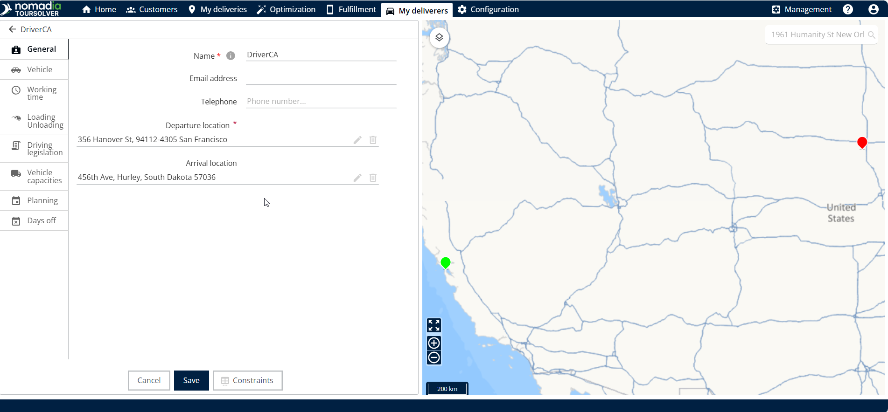
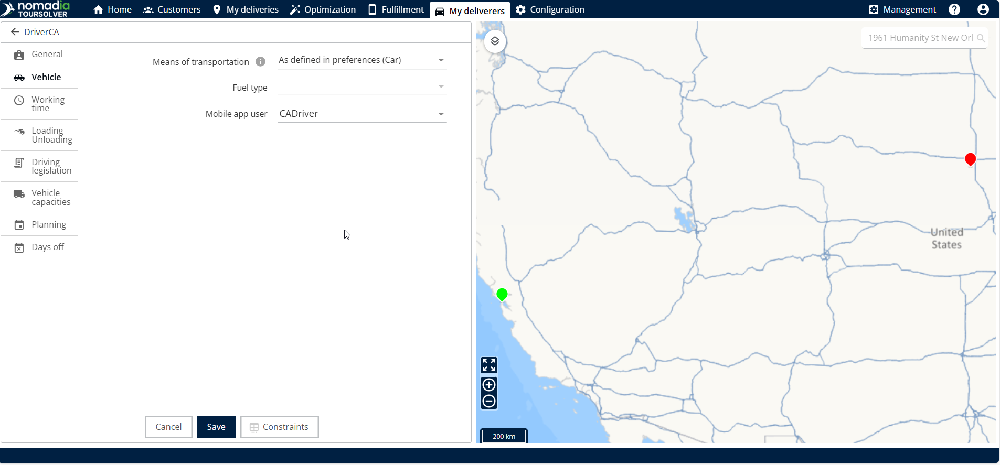
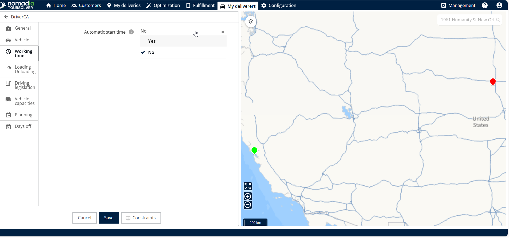
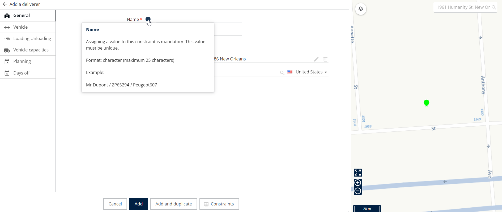

# Criação de um Recurso

## 1. Introdução

Bem-vindo! Este guia irá orientá-lo pelos passos simples para definir um Recurso, como um membro da equipe de entrega ou um motorista — dentro do TourSolver. Nosso objetivo é garantir que você possa configurar seus colaboradores de forma precisa e confiante, permitindo que o sistema gerencie atribuições de veículos, horários de trabalho e folgas de forma eficaz.

## 2. Configuração Inicial

Para começar a definir um novo perfil de recurso:

1. Vá para a **Página de recurso.**
2. Clique em **Adicionar** localizado no menu Ações.

<figure><figcaption></figcaption></figure>

## 3. Explicação de Funcionalidades e Benefícios

* Criar um recurso envolve preencher várias abas que definem como seu colaborador opera, se desloca e quando está disponível.
* **Detalhes do Recurso (Informações Gerais**): É aqui que você identifica o colaborador pelo nome e especifica seu ponto de partida, conhecido como local de partida.
* **Aba Veículos**: Aqui você define a maneira principal pela qual o colaborador se desloca selecionando o meio de transporte.
* **Aba Capacidades de Veículos**: Esta seção é crucial para definir o que o recurso (ou o veículo a ele atribuído) pode transportar. Você pode adicionar capacidades do veículo para garantir que as restrições sejam atendidas durante o planejamento.
* **Abas Horário de Trabalho e Planejamento**: Essas seções definem a disponibilidade do colaborador, incluindo selecionar se o recurso de início automático está ativo, definir períodos de trabalho específicos e agendar pausas para almoço.
* **Aba Dias de Folga**: Isso permite que você agende datas específicas em que o recurso estará indisponível

💡 Dica: Se você não tiver certeza sobre um campo ou restrição ao inserir detalhes, pode passar o mouse sobre os ícones de dica para esclarecimento. Cada dica fornece uma breve explicação sobre o que aquela restrição controla.

## 4. Criação do Recurso

Siga estes passos para criar e definir com sucesso seu novo membro da equipe de entrega ou motorista.

1. Digite o **nome completo do recurso**.
2. Digite o **local de partida** (onde o recurso inicia seu turno).

<figure><figcaption></figcaption></figure>

3. Vá para a **aba Veículos.**
4. Selecione o **meio de transporte** (por exemplo, carro, bicicleta, caminhão).

<figure><figcaption></figcaption></figure>

5. Vá para a **aba Horário de Trabalho.**
6. Selecione se deseja que o recurso de início automático esteja ativo (sim ou não).

<figure><figcaption></figcaption></figure>

### Definindo Capacidades do Veículo

Se seu recurso estiver transportando mercadorias, você deve definir seus limites de capacidade:

1. Vá para a **aba Capacidades de Veículos**.
2. Clique no símbolo de mais **(+)** localizado no canto inferior.
3. Adicione as capacidades de veículo necessárias nos campos disponíveis.

<figure><figcaption></figcaption></figure>

**Para Excluir um Slot de Capacidade:** Se precisar remover uma entrada de capacidade, clique no ícone de excluir localizado no lado direito.

### Gerenciando Horários de Trabalho (Planejamento)

A aba Planejamento permite definir os períodos específicos de trabalho e as pausas do recurso.

#### Para Adicionar/Editar Períodos de Trabalho:

1. Vá para a **aba Planejamento**.
2. Clique no **período de trabalho**.
3. Clique na **editar período** botão.
4. Adicione os horários específicos de trabalho e clique **editar**.

<figure><figcaption></figcaption></figure>

#### Para Gerenciar Pausas para Almoço:

1. Para editar o período de trabalho existente da pausa para almoço, clique em editar **pausa para almoço**.
2. Adicione a **horários da pausa para almoço.**
3. Clique em **editar** para salvar as alterações no período de trabalho da pausa para almoço.
4. Para excluir um slot de pausa para almoço, clique em **excluir pausa para almoço**.

<figure><figcaption></figcaption></figure>

### Adicionando Dias de Folga

Use a aba Dias de para agendar folgas planejadas:

1. Vá para a **Dias de Folga** aba.
2. Clique no ícone de mais **(+)** no lado direito para adicionar uma nova entrada.
3. Adicione os horários necessários (data de início/data de término) em que o recurso estará de folga.
4. Clique na **adicionar** ícone para salvar a entrada.

⚠ **Aviso**: Ao definir dias de folga, certifique-se de que a "Data Até" (a data de término) seja maior (mais tarde) do que a "Data De" (a data de início).

<figure><figcaption></figcaption></figure>

### Finalizando a Criação do Recurso

1. Depois de preencher todos os detalhes necessários nas várias abas. Clique em **Adicionar**.
2. O recurso será criado com sucesso.

<figure><figcaption></figcaption></figure>

## 5. Dicas de Produtividade

Estas dicas ajudarão você a gerenciar horários e restrições de forma rápida e eficiente:

* **Entenda as Restrições**: Se você não tiver certeza sobre o que uma configuração específica controla, utilize sempre os ícones de dica passando o mouse sobre eles para uma explicação rápida.

<figure><figcaption></figcaption></figure>

* **Duplicar Rapidamente Períodos de Trabalho**: Se um recurso tiver vários períodos de trabalho idênticos, você pode economizar tempo clicando na opção duplicar período de trabalho e então clicando duplicar para adicionar rapidamente uma cópia.

<figure><figcaption></figcaption></figure>

* **Gerenciando capacidade**: Lembre-se de que você sempre pode excluir capacidades de veículo indesejadas clicando no ícone de excluir no lado direito da entrada.
