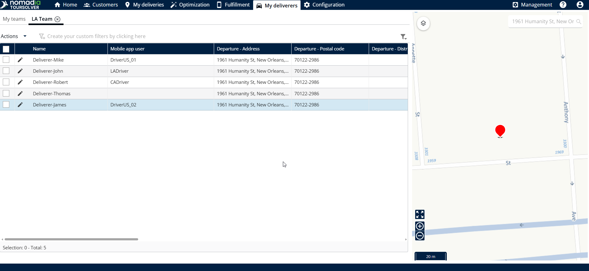
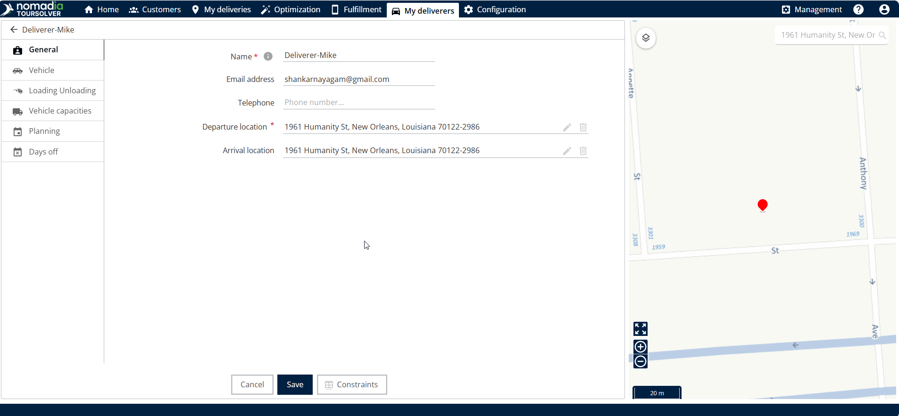
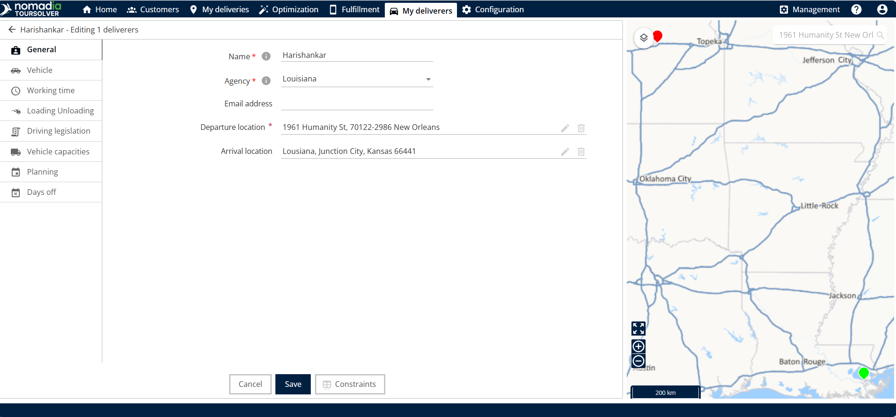
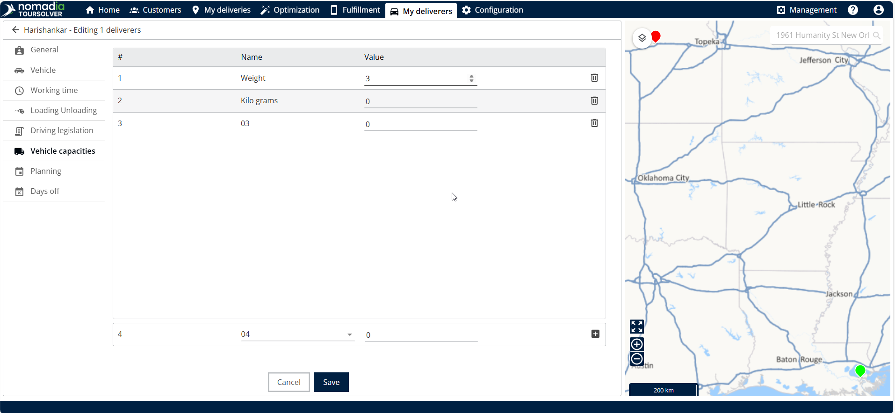
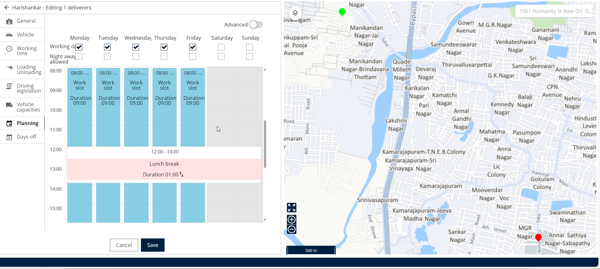
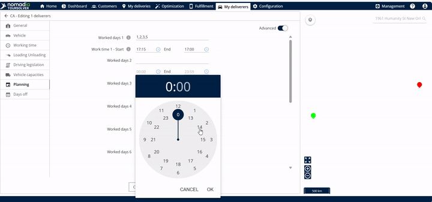
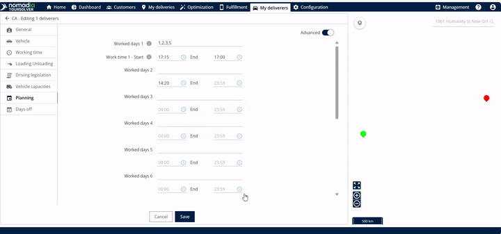

# Modificação de um Recurso e Restrições Associadas

## 1. Introdução

Bem-vindo ao seu guia para gerenciar e atualizar de forma eficiente seus recursos de entrega e suas principais restrições, ou "constraints". Saber como modificar um recurso — seja ajustando a disponibilidade de uma equipe ou alterando a capacidade do veículo de um indivíduo — é essencial para operações tranquilas. Neste guia, você aprenderá exatamente como alterar agendamentos, locais e capacidades de forma rápida e bem-sucedida

## 2. Configuração Inicial

Você pode começar a modificar recursos e constraints diretamente na página inicial do sistema.

#### Acessar Meus Entregadores

<figure><figcaption></figcaption></figure>

1. **Escolha Seu Método de Modificação:** Você tem duas maneiras principais de modificar um recurso: por equipe (afetando um grupo) ou individualmente.
2. Clique na **editar** (ícone de lápis) ao lado do nome

<figure><figcaption></figcaption></figure>

3. Você pode começar a modificar as constraints associadas.

<figure><figcaption></figcaption></figure>

## 3. Explicação de Funcionalidades e Benefícios

As constraints são as regras que governam quando, onde e como um recurso opera. Aqui estão as constraints comumente usadas explicadas:

* Local de Partida e Chegada: Esta configuração define o ponto de início e término do dia do recurso. Modificar esses locais é crucial se o endereço típico de início ou término do recurso mudar (por exemplo, se estiver trabalhando de um depósito diferente ou voltando para casa).
* Capacidades do Veículo: Isso permite definir limites na capacidade do veículo, normalmente medida por peso. Isso garante que seu veículo de entrega nunca fique sobrecarregado, o que ajuda com roteamento seguro e em conformidade. Você pode definir o valor do peso em quilogramas (kg) ou gramas (g).
* Planejamento (Janelas de Trabalho): Isso determina a disponibilidade de trabalho do recurso. Você pode gerenciar horários exatos de início e término e especificar em quais dias da semana ele está disponível.

**Dica**: Para saber mais sobre quaisquer outras constraints, consulte a documentação de constraints.

## 4. Modificando os Locais de Partida e Chegada

Depois de acessar a tela de modificação de constraints (usando o ícone de lápis), siga os passos abaixo para atualizar detalhes específicos do recurso.

Se o ponto de início ou término de um recurso mudar, você pode atualizá-lo aqui.

1. **Localize o Endereço**: Para modificar o local de partida ou chegada em geral, procure a seção relevante (Local de Partida ou Local de Chegada).
2. **Atualizar Endereço**: Modifique o endereço de partida e chegada conforme necessário.

<figure><figcaption></figcaption></figure>

Após a modificação, você verá as diferenças no mapa. A cor usada será diferente para os locais de partida e chegada (por exemplo, verde ou vermelho).

### Atualizando Capacidades do Veículo (Peso)

1. Você pode gerenciar o peso máximo que o veículo de um recurso pode transportar.
2. **Modificar Valor**: Modifique o valor do peso. Você pode inserir esse valor em quilogramas ou gramas.

<figure><figcaption></figcaption></figure>

A seção Planejamento controla quando seu recurso está disponível para trabalhar. Existem dois métodos para modificar os horários de trabalho: Visualização Simples e Visualização Avançada.

#### Visualização Simples (Mesmo Horário Todos os Dias)

Use a Visualização Simples se o horário de trabalho for o mesmo em todos os dias úteis.

1. **Acessar Planejamento**: Clique em Planejamento.
2. **Acessar Intervalo de Tempo**: Na Visualização Simples, clique no intervalo de tempo.
3. **Editar Janela de Trabalho**: Clique em Editar Workslot.
4. **Definir Horários de Início e Término**: Modifique o horário de início e o horário de término.
5. **Confirmar**: Clique em **Editar**.

<figure><figcaption></figcaption></figure>

#### Visualização Avançada (Horários Diferentes para Dias Diferentes)

Use a Visualização Avançada se você precisar definir horários únicos de início e término para dias de trabalho específicos.

1. **Acessar Planejamento**: Clique em Planejamento.
2. **Selecionar Dias de Trabalho**: Na Visualização Avançada, você pode modificar os "dias de trabalho" (por exemplo, dia de trabalho 1, dia de trabalho 2, etc.). Você pode especificar um intervalo, como 1 a 5, que representa segunda a sexta. Você também pode inserir dias específicos como 1, 2, 3, 4, 5.
3. **Fazer Ajustes**: A imagem do relógio será exibida, permitindo que você faça seus ajustes.
4. **Confirmar Horário**: Após fazer a modificação dentro do relógio, clique em OK.

<figure><figcaption></figcaption></figure>

#### Salvando Todas as Modificações

Depois de concluir todas as alterações necessárias em **Partida, Chegada, Capacidade e Planejamento:**

* As alterações serão exibidas com sucesso

<figure><figcaption></figcaption></figure>

## 5. Dicas de Produtividade

Para ajudá-lo a aproveitar ao máximo o gerenciamento de recursos:

* **Edição Eficiente de Horários**: Use o ícone de relógio ao lado do horário para abrir rapidamente a imagem do relógio e fazer ajustes precisos de tempo.
* **Exclusão Rápida**: Se precisar remover um valor específico de capacidade do veículo, procure imediatamente ao lado direito da entrada de peso pelo ícone de exclusão.
