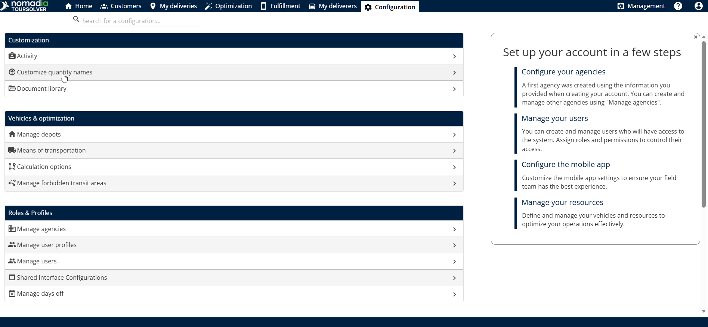
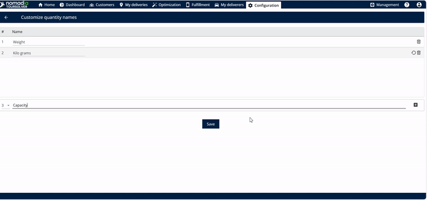
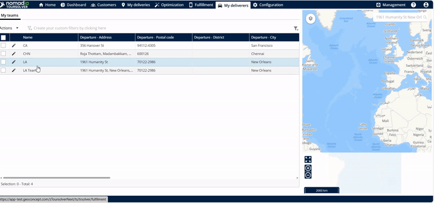
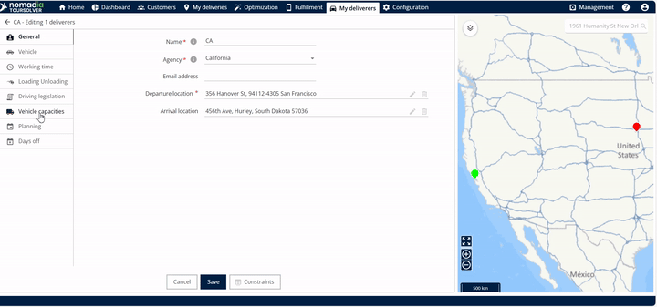
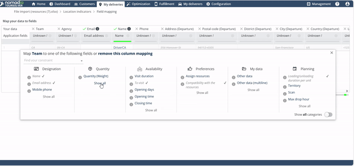

# Renomear uma Quantidade de um Veículo

## 1. Introdução

Renomear uma quantidade de veículo ajuda a personalizar a terminologia do seu sistema. Ao alterar esses nomes, você garante clareza e consistência ao visualizar capacidades de veículos e ao importar novas informações de entrega. Você está aprendendo como renomear com sucesso a quantidade de um veículo.

## 2. Configuração Inicial

Vá para _**Configuração → Recursos → Veículos**_**&#x20;e renomeie o campo Quantidade** para refletir seu rótulo preferido

## 3. Explicações e Benefícios do Recurso

A capacidade de personalizar nomes de quantidade oferece um benefício significativo ao exibir nomes definidos pelo usuário em duas áreas principais:

* **Visualização de Capacidade do Veículo**: Após renomear, os novos nomes são visíveis quando você verifica os detalhes de capacidade de um veículo. Isso permite verificar rapidamente quais limitações de capacidade estão atribuídas à sua frota.
* **Tela de Importação de Entregas**: Os novos nomes são exibidos quando você importa novas entregas. Especificamente, eles aparecem quando você seleciona Mostrar Tudo na seção de quantidade durante o processo de importação, garantindo o mapeamento correto dos dados.

## 4. Renomeando uma Quantidade de Veículo

Siga estes passos simples para atualizar os nomes de quantidade no seu sistema:

1. **Acesse Configuração**
2. **Navegue até Personalizar Nomes de Quantidade**

<figure><figcaption></figcaption></figure>

3. **Renomeie a Quantidade**
4. **Salve Suas Alterações**

<figure><figcaption></figcaption></figure>

## 5. Verificando Novos Nomes nas Capacidades do Veículo

1. **Vá para Meus Entregadores**
2. **Edite um Veículo**

<figure><figcaption></figcaption></figure>

3. **Visualize Capacidades do Veículo**
4. **Confirme o Nome**

<figure><figcaption></figcaption></figure>

## 6. Verificando Novos Nomes durante a Importação de Entregas

As quantidades renomeadas também são visíveis quando você importa entregas:

1. **Vá para Minhas Entregas**
2. **Iniciar Importação**
3. **Endereçar Campos Desconhecidos**
4. **Mostrar Todas as Quantidades**
5. **Confirme o Novo Nome**

<figure><figcaption></figcaption></figure>

## 7. Dicas de Produtividade

* **Dica**: Verificação Imediata é Fundamental Após salvar sua quantidade renomeada, reserve um momento para verificar imediatamente a alteração tanto nas Capacidades do Veículo quanto checando uma importação de entrega pendente Isso garante que suas alterações foram propagadas corretamente pelo sistema.
* **Dica**: Mantenha Simples Use nomes claros e concisos que sejam fáceis de entender por toda a sua equipe. Como o novo nome será exibido em múltiplas áreas, escolher uma linguagem acessível previne confusão.
* **Aviso**: Certifique-se de ter atualizado todos os campos necessários antes de Clicar em Salvar para evitar ter que retornar ao menu de personalização várias vezes.
